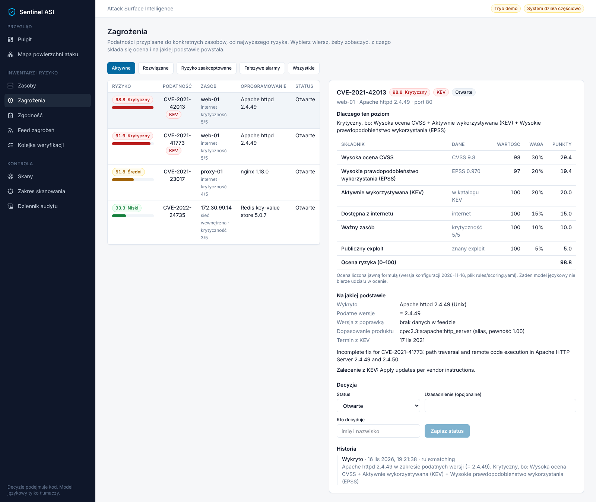
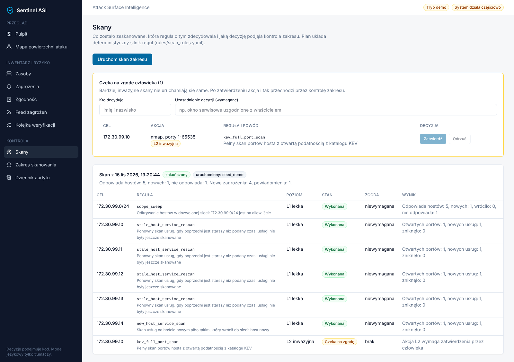
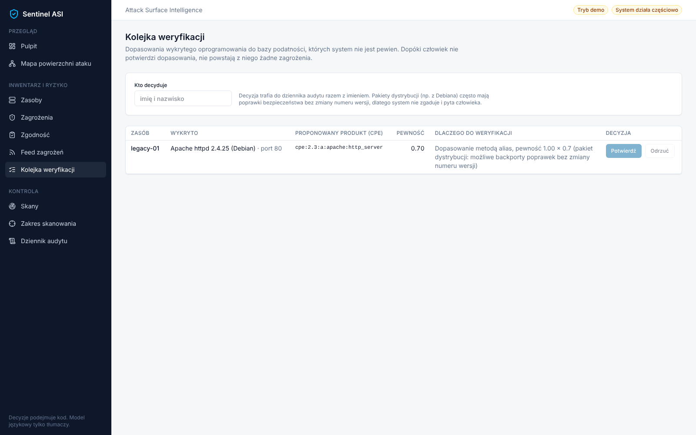
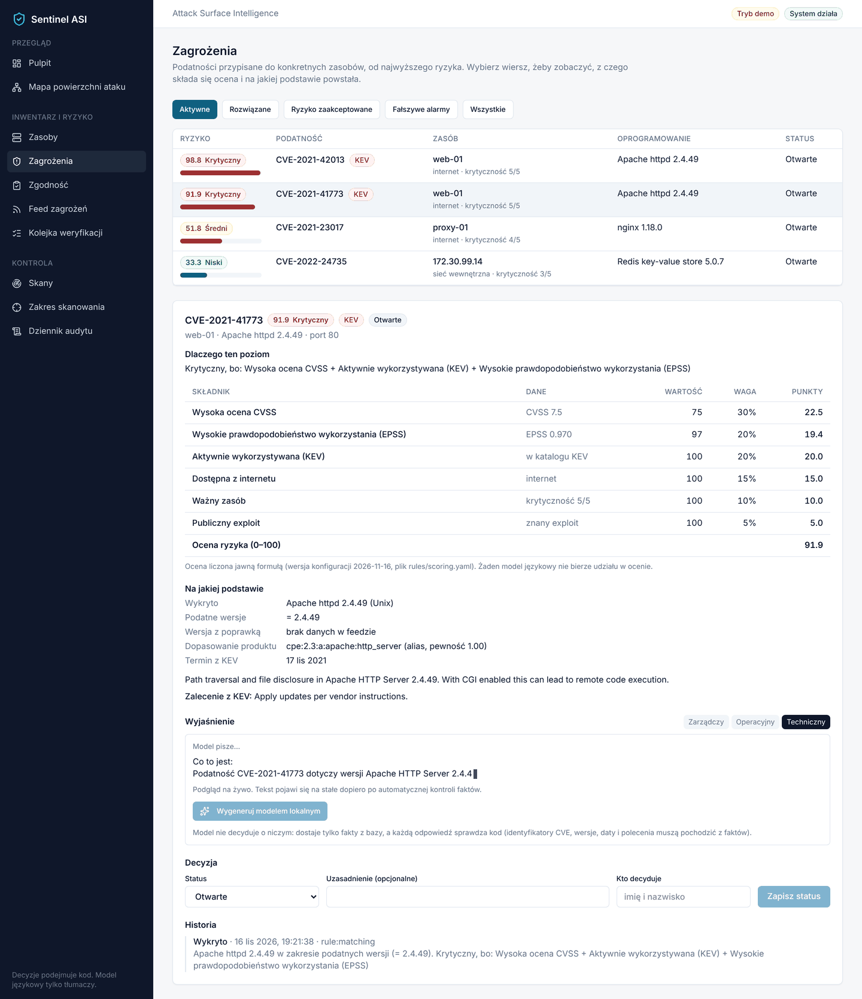

# Sentinel ASI

Platforma Attack Surface Intelligence: jeden centralny inwentarz zasobów, do którego
dopasowane są zagrożenia, aktualizacje, wyniki skanów i reguły zgodności. Projekt na
hackathon HackNation, zadanie „Attack Surface Intelligence” (AGH).

**Zasada:** decyzje (co skanować, jak ocenić ryzyko, czy wysłać alert) podejmuje
deterministyczny, testowalny kod. Lokalny model językowy służy wyłącznie do tłumaczenia
wyników na ludzki język.

> **Stan:** Etapy 0–3 zrobione, Etap 3b (aktualizacja architektury pod pełną specyfikację)
> czeka na akceptację. Ścieżka krytyczna działa od początku do końca, bez internetu: import
> inwentarza, skan usług, feedy ze snapshotów, dopasowanie podatności do zasobów, ocena ryzyka
> z rozbiciem, kolejka weryfikacji, powiadomienia. Do tego wyjaśnienia zagrożeń na trzech
> poziomach z lokalnego modelu, sprawdzane przez kod. Architektura i plan Etapów 4–9:
> [docs/ARCHITECTURE.md](docs/ARCHITECTURE.md); co poza linią cięcia:
> [docs/ROADMAP.md](docs/ROADMAP.md).

## Uruchomienie

```bash
cp .env.example .env        # ustaw POSTGRES_PASSWORD
docker compose up --build
```

Interfejs: <http://localhost:8080>. Dokumentacja API: <http://localhost:8080/api/docs>.
Po takim starcie zakres skanowania jest pusty i system niczego nie skanuje.

## Demo w 3 minuty (bez internetu)

```bash
# w pliku .env ustaw świadomie: DEMO_MODE=true
./scripts/seed_demo.sh
```

Skrypt uruchamia stos razem z celowo podatnym [demo-lab](demo-lab/README.md), importuje
fikcyjny inwentarz, wczytuje feedy ze snapshotów, skanuje sieć demo-lab i liczy ryzyko.
Trwa około minuty po zbudowaniu obrazów. Co zobaczysz:

| Widok | Co pokazuje |
|---|---|
| Zagrożenia | CVE-2021-41773 i CVE-2021-42013 na `web-01` jako krytyczne, z rozbiciem oceny na składniki i zdaniem „dlaczego”. |
| Feed zagrożeń | 9 znanych podatności, z czego 4 dotyczą naszych zasobów. |
| Kolejka weryfikacji | Apache 2.4.25 z Debiana na `legacy-01`: system nie zgaduje, czy poprawki są backportowane, i pyta człowieka. Zagrożenia powstają dopiero po potwierdzeniu. |
| Zasoby | `172.30.99.14` jako shadow IT (odpowiada, a nie ma go w inwentarzu), `old-db-01` jako zasób, który nie odpowiada. |
| Skany | Każda akcja z nazwą reguły i decyzją kontroli zakresu. Pełny skan portów (poziom L2) wykonany na podstawie zgody `seed_demo`. |
| Dziennik audytu | Każda decyzja: co, kiedy, która reguła, na podstawie jakich danych. |

Żeby zobaczyć zatwierdzanie przez człowieka, uruchom skrypt z pustą zgodą:
`DEMO_APPROVAL_EXPIRES_AT=1970-01-01T00:00:00Z ./scripts/seed_demo.sh`. Skan L2 pojawi się
wtedy w widoku Skany jako „Czeka na zgodę”.





### Feedy: snapshoty i tryb online

Domyślnie (`FEEDS_MODE=offline`) system czyta feedy z plików w `data/feeds/`, które nie
trafiają do Gita. Pobiera je `./scripts/fetch_feeds.sh` (wymaga internetu; uruchom po
zaimportowaniu inwentarza, przed prezentacją bez sieci). Gdy `data/feeds/` jest puste,
`seed_demo` używa miniaturowego, ręcznie przygotowanego zestawu z
`backend/tests/fixtures/feeds/` (9 publicznie znanych CVE, wartości EPSS fikcyjne i tak oznaczone w pliku; interfejs pokazuje wtedy etykietę „Dane demonstracyjne”).

### Wyjaśnienia z lokalnego modelu (opcjonalnie)

System działa w pełni bez modelu: każde zagrożenie ma wtedy wyjaśnienie z szablonu,
zbudowane przez kod z danych w bazie.

**Domyślny model: Qwen3 4B (Q4_K_M)**, ustawiony w `.env.example` jako
`LLM_MODEL=qwen3-4b-q4km`. W ewaluacji z promptami v2 jego odpowiedzi przechodzą walidator w
93% przypadków (poziom techniczny 95%), Bielika 4.5B w 70%; szczegóły w
[eval/RESULTS.md](eval/RESULTS.md). Żeby go włączyć:

```bash
./scripts/fetch_models.sh          # Qwen3 4B, około 2,5 GB, przypięta rewizja i suma SHA-256
docker compose up -d
```

**Opcja: Bielik 4.5B v3.0** (`LLM_MODEL=bielik-4.5b-q4km`). Pisze lepszą polszczyzną, ale
częściej wychodzi poza fakty, więc częściej dostajesz wersję z szablonu. Oficjalne
repozytorium nie publikuje wariantu Q4_K_M, więc `fetch_models.sh` pobiera fp16 (9,5 GB) i
kwantyzuje go obrazem `ghcr.io/ggml-org/llama.cpp`. **Ta ścieżka nie jest zweryfikowana**:
kwantyzację sprawdziłem tylko llama.cpp uruchomionym poza Dockerem, bo obraz z GHCR nie był
dostępny w moim środowisku.

Model działa w Ollamie, w sieci bez dostępu do internetu. W widoku Zagrożenia panel
„Wyjaśnienie” ma trzy poziomy (zarządczy, operacyjny, techniczny) i pokazuje odpowiedź na
żywo. Model dostaje wyłącznie fakty z bazy, bez nazw i adresów zasobów; kontekst zasobu
dokleja kod. Każdą odpowiedź sprawdza walidator: identyfikatory CVE, wersje, daty i polecenia
muszą pochodzić z faktów, inaczej użytkownik dostaje wersję z szablonu. Tekst dla danego CVE
i poziomu powstaje raz i trafia do cache. `seed_demo` zleca generowanie w tle, gdy model
jest skonfigurowany. Na 4 rdzeniach jedna odpowiedź trwa zwykle 15–40 s.

Zewnętrzny model jest domyślnie wyłączony (`EXTERNAL_LLM_ENABLED=false`). Po świadomym
włączeniu przez administratora dostaje tylko tekst po anonimizacji (zasoby jako
`asset_<id>`, adresy IP, domeny i e-maile zamaskowane), a każde użycie trafia do dziennika
audytu.



## Wymagania sprzętowe

4+ rdzenie CPU, 16 GB RAM, około 30 GB SSD, Docker z Compose. **GPU nie jest wymagane.**

## Co już działa

| Obszar | Opis |
|---|---|
| `scope_guard` | Jedyna brama dla aktywnych działań sieciowych. Zakres domyślnie pusty, denylista przed allowlistą, sprawdzenie po rozwiązaniu DNS, zgoda człowieka na skany inwazyjne, limit szybkości per cel. Test architektury pilnuje, żeby żaden moduł nie sięgał do sieci z pominięciem bramy. |
| Dziennik audytu | Tylko do dopisywania (trigger w bazie) z łańcuchem skrótów. |
| Inwentarz | Import CSV, scalanie importu ze skanem po odcisku zasobu, shadow IT, zasoby, które przestały odpowiadać, historia zmian usług. |
| Scan Planner | Deterministyczne reguły w [`rules/scan_rules.yaml`](rules/scan_rules.yaml). Przy każdej akcji zapisana jest reguła, która ją wywołała. |
| Skanowanie | nmap jako adapter przyjmujący wyłącznie cel wydany przez `scope_guard`. Narzędzia są tylko w obrazie skanera. |
| Feedy | NVD, CISA KEV, EPSS. Jedna ścieżka kodu dla trybu online i dla snapshotów offline. |
| Dopasowanie | Słownik aliasów, CPE z narzędzia, dopasowanie rozmyte z progami w [`rules/matching.yaml`](rules/matching.yaml). Niska pewność trafia do kolejki weryfikacji. Nieznana wersja nie tworzy zagrożenia. |
| Ocena ryzyka | Jawna formuła z wagami w [`rules/scoring.yaml`](rules/scoring.yaml), rozbicie na składniki i zdanie „dlaczego” budowane przez kod. |
| Powiadomienia | Reguły w [`rules/notifications.yaml`](rules/notifications.yaml): grupowanie per zasób, bez powtórek w ciągu doby. E-mail, Slack i Teams są wyłączone do czasu konfiguracji w `.env`. |
| AI Explainer | Wyjaśnienia na trzech poziomach z lokalnego modelu (Ollama), generowane raz i trzymane w cache, z walidatorem faktów i wersją z szablonu, gdy model jest niedostępny albo się myli. Streaming przez SSE. Prompty wersjonowane w `backend/app/explainer/prompts/`, limity w [`rules/explainer.yaml`](rules/explainer.yaml). |
| Kolejki | Osobne kolejki Celery: `default`, `scans`, `feeds`, `llm` (zawsze jedno zadanie naraz). |
| Interfejs | Pulpit, Zasoby, Zagrożenia, Feed zagrożeń, Kolejka weryfikacji, Skany, Zakres skanowania, Dziennik audytu. |

## Zakres skanowania

Zakres ustawia się w [`rules/scope.yaml`](rules/scope.yaml). Domyślnie jest pusty, więc
system niczego nie skanuje. Każda decyzja bramy (także odmowa) trafia do dziennika audytu.

Tryb demo (`DEMO_MODE=true`) pozwala skryptowi `seed_demo` zastąpić kliknięcie człowieka
przy skanach inwazyjnych, ale wyłącznie w sieci demo-lab, do daty wygaśnięcia i nadal
przez `scope_guard`. Domyślnie jest wyłączony.

## Rozwój

```bash
# backend
cd backend
uv sync --extra dev
uv run ruff check . && uv run ruff format --check . && uv run mypy app tests
uv run pytest                 # bez sieci, bez bazy, bez modelu

# frontend
cd frontend
npm ci
npm run lint && npm run typecheck && npm run build
npm run dev                   # http://localhost:5173, proxy /api na :8000
```

Zmiany trafiają do `main` wyłącznie przez pull requesty z gałęzi etapowych
(`stage-N-nazwa`), w konwencji Conventional Commits.

## demo-lab

Katalog [`demo-lab/`](demo-lab/README.md) opisuje **celowo podatne** usługi do testów.
Działają w sieci Dockera oznaczonej `internal: true`: bez wyjścia na zewnątrz i bez portów
na hoście. Widzi je wyłącznie kontener skanera. Startują tylko z profilem `demo`.
Nie uruchamiaj ich w żadnej innej konfiguracji.

## Ograniczenia

- System wykrywa i weryfikuje, **nie eksploatuje** podatności.
- Nie „wykrywa zero-dayów”. Szybko łapie wczesne sygnały i odpowiada, czy i gdzie
  organizacja jest narażona.
- API nie ma jeszcze logowania użytkowników, dlatego interfejs jest dostępny tylko z
  `localhost`. Keycloak, MFA i RBAC to Etap 4.
- Skany inwazyjne (L2) to na razie pełny skan portów. Weryfikacja podatności szablonami
  (nuclei) dochodzi w Etapie 5 razem z serwerem MCP skanerów.
- Powiadomienia zbiorcze (digest) są zapisywane, ale ich wysyłka powstaje w Etapie 4b.
- Walidator wyjaśnień sprawdza pochodzenie identyfikatorów, wersji, dat, poleceń i linków,
  ale nie sens zdań. Model może więc nieprecyzyjnie streścić fakt (przykłady w
  [eval/RESULTS.md](eval/RESULTS.md)). Dlatego decyzje i ocena ryzyka nigdy nie zależą od
  tekstu modelu, a obok wyjaśnienia zawsze widać fakty z bazy.
- W repozytorium nie ma modeli, snapshotów feedów, wyników skanów ani danych o
  rzeczywistej infrastrukturze.
