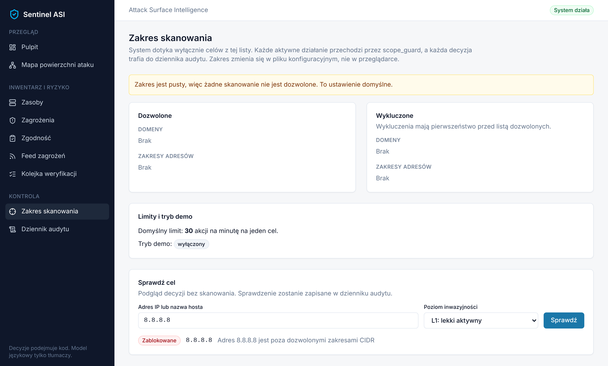
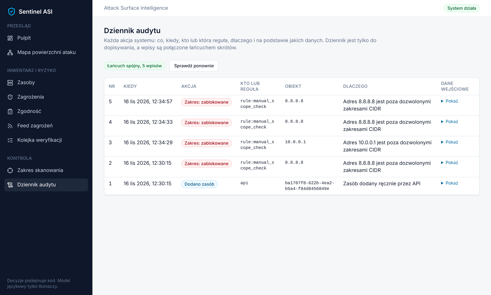

# Sentinel ASI

Platforma Attack Surface Intelligence: jeden centralny inwentarz zasobów, do którego
dopasowane są zagrożenia, aktualizacje, wyniki skanów i reguły zgodności. Projekt na
hackathon HackNation, zadanie „Attack Surface Intelligence” (AGH).

**Zasada:** decyzje (co skanować, jak ocenić ryzyko, czy wysłać alert) podejmuje
deterministyczny, testowalny kod. Lokalny model językowy służy wyłącznie do tłumaczenia
wyników na ludzki język.

> **Stan:** Etap 1 z 6 (szkielet). Działa: stos Docker Compose, baza z migracjami, API,
> interfejs z nawigacją, `scope_guard` i dziennik audytu. Skanowanie, feedy i scoring
> powstają w Etapie 2. Plan: [docs/ARCHITECTURE.md](docs/ARCHITECTURE.md), sekcja 12.

## Uruchomienie

```bash
cp .env.example .env        # ustaw POSTGRES_PASSWORD
docker compose up --build
```

Interfejs: <http://localhost:8080>. Dokumentacja API: <http://localhost:8080/api/docs>.

## Wymagania sprzętowe

4+ rdzenie CPU, 16 GB RAM, około 30 GB SSD, Docker z Compose. **GPU nie jest wymagane.**

## Co już działa

| Obszar | Opis |
|---|---|
| `scope_guard` | Jedyna brama dla aktywnych działań sieciowych. Zakres domyślnie pusty, denylista przed allowlistą, sprawdzenie po rozwiązaniu DNS, zgoda człowieka na skany inwazyjne, limit szybkości per cel. |
| Dziennik audytu | Tylko do dopisywania (trigger w bazie) z łańcuchem skrótów. Każda decyzja `scope_guard` jest zapisywana razem z regułą i danymi wejściowymi. |
| Inwentarz | Model danych wszystkich modułów, API zasobów, deduplikacja po odcisku zasobu. |
| Kolejki | Osobne kolejki Celery: `default`, `scans`, `feeds`, `llm` (zawsze jedno zadanie naraz). |
| Interfejs | Polska nawigacja, widoki: Pulpit, Zasoby, Zakres skanowania, Dziennik audytu. |




## Zakres skanowania

Zakres ustawia się w [`rules/scope.yaml`](rules/scope.yaml). Domyślnie jest pusty, więc
system niczego nie skanuje. Każda decyzja bramy (także odmowa) trafia do dziennika audytu.

Tryb demo (`DEMO_MODE=true`) pozwala skryptowi `seed_demo` zastąpić kliknięcie człowieka
przy skanach inwazyjnych, ale wyłącznie w sieci demo-lab, do daty wygaśnięcia i nadal
przez `scope_guard`. Domyślnie jest wyłączony.

## Rozwój

```bash
# backend
cd backend
uv sync --extra dev
uv run ruff check . && uv run ruff format --check . && uv run mypy app tests
uv run pytest                 # bez sieci, bez bazy, bez modelu

# frontend
cd frontend
npm ci
npm run lint && npm run typecheck && npm run build
npm run dev                   # http://localhost:5173, proxy /api na :8000
```

Zmiany trafiają do `main` wyłącznie przez pull requesty z gałęzi etapowych
(`stage-N-nazwa`), w konwencji Conventional Commits.

## demo-lab

Katalog `demo-lab/` (od Etapu 2) zawiera **celowo podatne** usługi do testów. Działają w
sieci Dockera oznaczonej `internal: true`: bez wyjścia na zewnątrz i bez portów na hoście.
Nie uruchamiaj ich w żadnej innej konfiguracji.

## Ograniczenia

- System wykrywa i weryfikuje, **nie eksploatuje** podatności.
- Nie „wykrywa zero-dayów”. Szybko łapie wczesne sygnały i odpowiada, czy i gdzie
  organizacja jest narażona.
- API nie ma jeszcze logowania użytkowników, dlatego interfejs jest dostępny tylko z
  `localhost`. Konta i role są zaplanowane jako osobne zadanie.
- W repozytorium nie ma modeli, snapshotów feedów, wyników skanów ani danych o
  rzeczywistej infrastrukturze.
