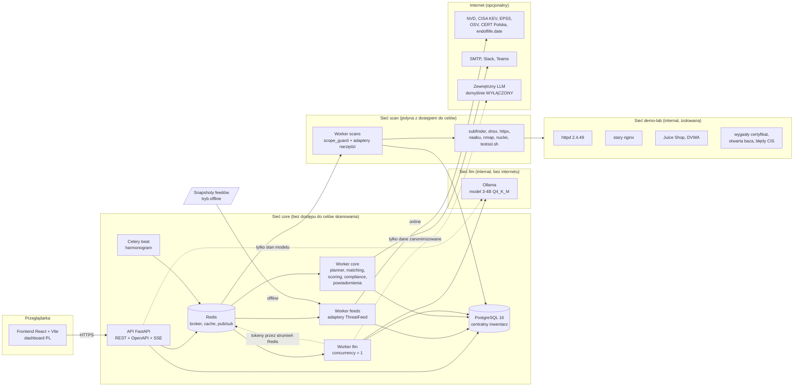
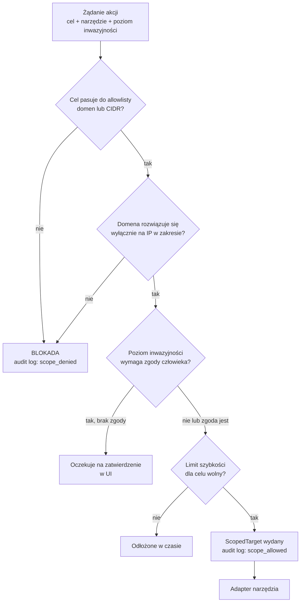
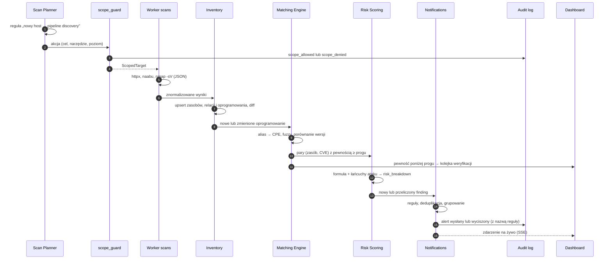
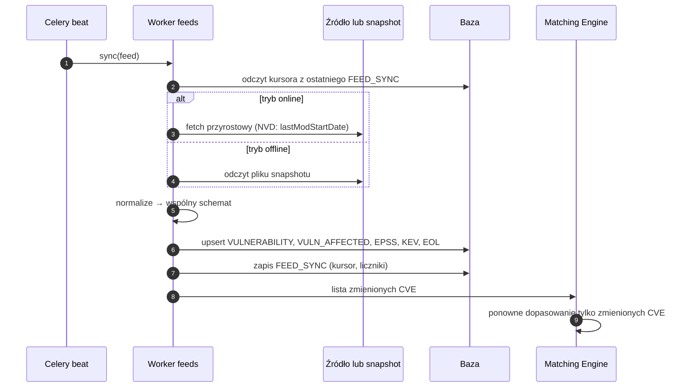
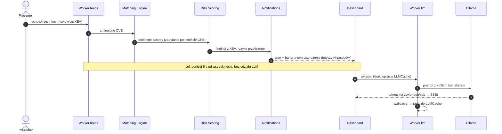

# Sentinel ASI: architektura

Status: **zaakceptowany 2026-11-16 (Etap 0)**. Kod powstaje od Etapu 1.
Data: 2026-11-16. Kontekst: HackNation, zadanie „Attack Surface Intelligence” (AGH).

## Spis treści

1. [Założenia i zakres](#1-założenia-i-zakres)
2. [Widok komponentów](#2-widok-komponentów)
3. [Izolacja sieci i scope_guard](#3-izolacja-sieci-i-scope_guard)
4. [Model danych (ERD)](#4-model-danych-erd)
5. [Przepływy danych](#5-przepływy-danych)
6. [Matching Engine](#6-matching-engine)
7. [Risk Scoring](#7-risk-scoring)
8. [AI Explainer](#8-ai-explainer)
9. [Budżet zasobów (CPU-only, 16 GB)](#9-budżet-zasobów-cpu-only-16-gb)
10. [Decyzje projektowe z uzasadnieniem](#10-decyzje-projektowe-z-uzasadnieniem)
11. [Ryzyka](#11-ryzyka)
12. [Kolejność realizacji i linia cięcia](#12-kolejność-realizacji-i-linia-cięcia)
13. [Ustalenia i otwarte kwestie](#13-ustalenia-i-otwarte-kwestie)

---

## 1. Założenia i zakres

Sentinel ASI odpowiada na jedno pytanie: **„czy i gdzie jesteśmy narażeni, jak bardzo i co z tym zrobić”**. Robi to, łącząc wszystko przez jeden centralny inwentarz zasobów. Każde CVE, aktualizacja, wynik skanu i reguła compliance wisi na konkretnym zasobie. System nie ma widoku „lista CVE ze świata”, ma widok „CVE, które dotyczą nas”.

Zasada nadrzędna: **decyzje podejmuje deterministyczny kod, LLM tylko mówi do człowieka.**

| Obszar | Kto decyduje | Jak to sprawdzić |
|---|---|---|
| Co i kiedy skanować | silnik reguł YAML (Scan Planner) | wpis w audit logu z nazwą reguły |
| Czy działanie jest w zakresie | `scope_guard` | testy jednostkowe i test architektury |
| Czy CVE dotyczy zasobu | Matching Engine (CPE + zakresy wersji) | pewność dopasowania i dowód w findingu |
| Jaki jest priorytet | jawna formuła z wagami w konfiguracji | `risk_breakdown` widoczny w UI |
| Czy wysłać alert | reguły powiadomień YAML | wpis w audit logu z nazwą reguły |
| Jak to wytłumaczyć człowiekowi | **LLM** (lokalny, z walidacją) | cache, wersja promptu, walidator |

Czego system **nie** robi: nie eksploatuje podatności, nie skanuje poza zakresem, nie „wykrywa zero-dayów”. Łapie wczesne sygnały (KEV, advisory, CERT Polska) i w kilka sekund mówi, które zasoby są dotknięte i jak się bronić do czasu patcha.

Założenia robocze (do korekty, patrz [sekcja 13](#13-ustalenia-i-otwarte-kwestie)): laptop demo z 4+ rdzeniami, 16 GB RAM, bez GPU, z Dockerem i Compose; prezentacja bez internetu; brak klucza NVD w dniu startu.

---

## 2. Widok komponentów



### Odpowiedzialności

| Komponent | Odpowiedzialność | Kolejka Celery |
|---|---|---|
| API | REST, OpenAPI, autoryzacja, SSE (streaming LLM i zdarzenia na żywo), eksporty | brak |
| Worker `scans` | uruchamianie adapterów narzędzi, wyłącznie przez `scope_guard`, rate limiting | `scans` |
| Worker `feeds` | pobieranie i normalizacja feedów, snapshoty offline | `feeds` |
| Worker `core` | Scan Planner, Matching Engine, Risk Scoring, Compliance, Updates i EOL, powiadomienia, digesty | `default` |
| Worker `llm` | jedyne miejsce rozmowy z modelem, jedno zadanie naraz | `llm` (concurrency=1) |
| Celery beat | harmonogram feedów, skanów cyklicznych i digestów | brak |
| Ollama | lokalna inferencja, model z `LLM_MODEL` w `.env` | brak |

Kolejka `default` jest dodatkiem do trzech wymaganych (`scans`, `feeds`, `llm`). Uzasadnienie: matching i scoring nie mogą czekać za długim skanem ani za wolną generacją tekstu, bo od nich zależy czas reakcji w scenariuszu zero-day.

### Struktura backendu

```
backend/app/
├── api/            # routery FastAPI, schematy Pydantic, SSE
├── core/           # konfiguracja, logi JSON, audit, scope_guard
├── models/         # SQLAlchemy 2
├── inventory/      # discovery, import CSV/JSON, deduplikacja, historia
├── planner/        # silnik reguł skanowania
├── scanners/       # adaptery narzędzi (interfejs ToolAdapter)
├── feeds/          # adaptery ThreatFeed
├── matching/       # aliasy, CPE, porównywanie wersji
├── scoring/        # formuła, łańcuchy ataku
├── compliance/     # silnik reguł compliance
├── updates/        # rekomendacje aktualizacji, EOL
├── explainer/      # LLMProvider, prompty, cache, walidacja, RAG
├── notifications/  # reguły, kanały, deduplikacja, digesty
├── reports/        # Jinja2 + WeasyPrint
└── workers/        # zadania Celery
```

---

## 3. Izolacja sieci i scope_guard

Zakres jest egzekwowany na dwóch niezależnych warstwach. Błąd w jednej nie otwiera drogi poza zakres.

**Warstwa 1: kod.** Moduł `core/scope_guard.py` jest jedynym miejscem, które może wydać obiekt `ScopedTarget`. Adaptery narzędzi i funkcja uruchamiająca procesy przyjmują wyłącznie `ScopedTarget`, nigdy zwykły napis. Żeby więc cokolwiek przeskanować, trzeba przejść przez `scope_guard`, bo inaczej kod się nie typuje i nie uruchomi.



Reguły `scope_guard`:

- allowlista domen (z obsługą `*.example.lab`) i zakresów CIDR z konfiguracji; domyślnie pusta, czyli **nic nie jest dozwolone**,
- denylista ma pierwszeństwo przed allowlistą,
- domena jest sprawdzana także po rozwiązaniu DNS: każdy zwrócony adres musi leżeć w dozwolonym CIDR, a do narzędzia trafia już adres IP (ochrona przed podmianą DNS między sprawdzeniem a skanem),
- wyniki discovery (np. subdomeny z subfindera) nie są automatycznie w zakresie: każda trafia z powrotem do `scope_guard`,
- każda decyzja, pozytywna i negatywna, trafia do audit logu.

**Poziomy inwazyjności:**

| Poziom | Przykłady | Zgoda człowieka |
|---|---|---|
| L0 pasywny | subfinder (źródła pasywne), feedy, import CSV | nie |
| L1 lekki aktywny | dnsx, httpx, naabu (top porty), nmap `-sV`, nuclei tylko szablony `info` i wykrywanie technologii, testssl.sh | nie, ale w zakresie i z limitem |
| L2 inwazyjny | nuclei z szablonami weryfikującymi podatność, pełny zakres portów | **tak**, zatwierdzenie w UI, z nazwiskiem i powodem |
| zabronione | szablony `dos`, `fuzz`, `intrusive`, brute force, eksploatacja | nigdy, zablokowane na stałe w adapterze |

**Zgoda `seed_demo` na L2 w demo-lab.** Żeby pełny cykl dało się odtworzyć jednym poleceniem, `seed_demo` może zapisać zgodę zastępującą kliknięcie człowieka. Warunki (zaakceptowane 2026-11-16):

- działa wyłącznie przy `DEMO_MODE=true` w `.env`; wartość domyślna to `false`,
- obejmuje wyłącznie CIDR wewnętrznej sieci Dockera demo-lab (sieć `internal: true`, bez wyjścia na zewnątrz); CIDR jest stały w Compose i zgoda jest z nim porównywana, nie z allowlistą użytkownika,
- **nie omija `scope_guard`**: każda akcja nadal przechodzi pełną ścieżkę z diagramu, a zgoda zastępuje tylko krok „zatwierdzenie w UI”,
- wpis zgody w audit logu ma aktora `seed_demo` i datę wygaśnięcia; po tej dacie akcje L2 znów czekają na człowieka,
- testy jednostkowe: zgoda `seed_demo` nie działa dla żadnego adresu spoza sieci demo-lab (w tym adresów z allowlisty), nie działa przy `DEMO_MODE=false` i nie działa po wygaśnięciu.

**Warstwa 2: sieć Dockera.** Tylko worker `scans` jest podłączony do sieci, z której widać cele. API, baza, Ollama i pozostałe workery nie mają fizycznej drogi do skanowanych hostów. Sieć `demo-lab` ma `internal: true`, więc podatne kontenery nie mają wyjścia na świat i nie wystawiają portów na hosta.

**Testy, które to potwierdzają:**

1. Testy jednostkowe `scope_guard`: allowlista, denylista, granice CIDR, wildcardy, IPv6, domena rozwiązująca się poza zakres, pusta konfiguracja.
2. Test architektury (AST): moduły `subprocess`, `socket`, `httpx`, `requests` i `asyncio.create_subprocess_*` mogą być importowane tylko z jawnie wymienionych plików. Nowy plik sięgający do sieci wywala CI.
3. Test kontraktu: każdy adapter wywołany z czymś innym niż `ScopedTarget` rzuca wyjątek.
4. Test integracyjny: planner dostaje zasób spoza zakresu i żadna akcja nie powstaje, a w audit logu jest `scope_denied`.

Ruch wychodzący do feedów i kanałów powiadomień nie jest skanowaniem, ale też ma swoją allowlistę hostów (`egress_guard` w tym samym module), żeby żaden adapter nie mógł wysłać danych w dowolne miejsce.

---

## 4. Model danych (ERD)

```mermaid
erDiagram
    ASSET ||--o{ ASSET_RELATION : "źródło"
    ASSET ||--o{ ASSET_RELATION : "cel"
    ASSET ||--o{ ASSET_HISTORY : "wersje"
    ASSET ||--o{ SOFTWARE : "ma"
    ASSET ||--o{ FINDING : "dotyczy"
    ASSET ||--o{ COMPLIANCE_RESULT : "oceniany"
    SOFTWARE ||--o{ MATCH_CANDIDATE : "kandydaci CPE"
    SOFTWARE ||--o{ FINDING : "źródło"
    SOFTWARE ||--o{ UPDATE_RECOMMENDATION : "zalecenie"
    VULNERABILITY ||--o{ VULN_AFFECTED : "zakresy wersji"
    VULNERABILITY ||--o{ FINDING : "powoduje"
    COMPLIANCE_RULE ||--o{ COMPLIANCE_RESULT : "wynik"
    COMPLIANCE_RULE ||--o{ FINDING : "luka"
    FINDING ||--o{ FINDING_EVENT : "historia"
    FINDING ||--o{ NOTIFICATION : "zgłasza"
    SCAN_RUN ||--o{ SCAN_ACTION : "zawiera"
    ASSET ||--o{ SCAN_ACTION : "cel"
    APP_USER ||--o{ SCAN_ACTION : "zatwierdza"
    FEED_SYNC ||--o{ VULNERABILITY : "aktualizuje"

    ASSET {
        uuid id PK
        string type "host, domain, ip, service, application"
        string name
        string fingerprint UK "klucz deduplikacji"
        string exposure "internet, internal"
        int criticality "1-5"
        string owner
        jsonb tags
        jsonb attributes "port, protokół, banner"
        string status "active, missing, retired, shadow"
        timestamptz first_seen
        timestamptz last_seen
    }
    ASSET_RELATION {
        uuid id PK
        uuid source_id FK
        uuid target_id FK
        string type "resolves_to, runs, hosts, depends_on"
        timestamptz first_seen
        timestamptz last_seen
    }
    ASSET_HISTORY {
        uuid id PK
        uuid asset_id FK
        uuid scan_run_id FK
        string change "created, updated, missing, returned"
        jsonb diff
        timestamptz created_at
    }
    SOFTWARE {
        uuid id PK
        uuid asset_id FK
        string vendor
        string product
        string version
        string raw_banner
        string cpe "null do czasu dopasowania"
        string source "nmap, httpx, nuclei, import, sbom"
        float match_confidence "0-1"
        string match_status "auto, needs_review, confirmed, rejected"
        timestamptz first_seen
        timestamptz last_seen
    }
    MATCH_CANDIDATE {
        uuid id PK
        uuid software_id FK
        string cpe
        float score
        string method "alias, fuzzy"
        string decision "pending, accepted, rejected"
        string decided_by
        timestamptz decided_at
    }
    VULNERABILITY {
        uuid id PK
        string cve_id UK
        text description
        float cvss_score
        string cvss_vector
        float epss
        float epss_percentile
        bool in_kev
        date kev_due_date
        bool has_public_exploit
        jsonb references
        string source "nvd, kev, osv, cert_pl"
        timestamptz published
        timestamptz last_modified
    }
    VULN_AFFECTED {
        uuid id PK
        uuid vulnerability_id FK
        string cpe_vendor
        string cpe_product
        string version_exact
        string start_including
        string start_excluding
        string end_including
        string end_excluding
        string fixed_version
    }
    FINDING {
        uuid id PK
        uuid asset_id FK
        uuid software_id FK
        uuid vulnerability_id FK
        string rule_id FK
        string type "cve, misconfig, compliance, eol, exposure"
        string dedup_key UK
        string status "open, acknowledged, in_progress, resolved, accepted_risk, false_positive"
        float risk_score "0-100"
        string risk_level "krytyczny, wysoki, średni, niski"
        jsonb risk_breakdown
        jsonb evidence
        string assignee
        timestamptz first_seen
        timestamptz last_seen
    }
    FINDING_EVENT {
        uuid id PK
        uuid finding_id FK
        string kind "created, rescored, status_changed, reopened"
        jsonb before
        jsonb after
        string actor
        string reason
        timestamptz created_at
    }
    COMPLIANCE_RULE {
        string id PK "np. CIS-5.2.1"
        string framework "CIS, NIS2, ISO27001"
        jsonb mappings "odpowiedniki w innych frameworkach"
        string title
        text description
        jsonb check "sposób sprawdzenia"
        text remediation
        string severity
    }
    COMPLIANCE_RESULT {
        uuid id PK
        uuid asset_id FK
        string rule_id FK
        string result "pass, fail, na"
        jsonb evidence
        timestamptz checked_at
    }
    UPDATE_RECOMMENDATION {
        uuid id PK
        uuid software_id FK
        string current_version
        string recommended_version
        jsonb fixed_cves
        bool is_eol
        date eol_date
        timestamptz created_at
    }
    LLM_CACHE {
        uuid id PK
        string cache_key UK "typ + cve_id lub rule_id + poziom + wersja promptu"
        string kind "explanation, summary, digest"
        string audience "technical, operational, executive"
        string prompt_version
        text content
        string model
        int tokens
        int duration_ms
        string validation "passed, fallback"
        timestamptz created_at
    }
    SCAN_RUN {
        uuid id PK
        string trigger "schedule, manual, new_asset, seed"
        string status
        jsonb summary
        timestamptz started_at
        timestamptz finished_at
    }
    SCAN_ACTION {
        uuid id PK
        uuid scan_run_id FK
        uuid asset_id FK
        string tool
        string rule_name "reguła plannera"
        int intrusiveness "0-2"
        string status "planned, awaiting_approval, running, done, denied, failed"
        uuid approved_by FK
        string scope_decision
        timestamptz created_at
    }
    FEED_SYNC {
        uuid id PK
        string feed "nvd, kev, epss, osv, cert_pl, eol"
        string mode "online, offline"
        string status
        string cursor "np. lastModified"
        int items_new
        int items_updated
        timestamptz started_at
        timestamptz finished_at
    }
    NOTIFICATION {
        uuid id PK
        uuid finding_id FK
        string rule_name
        string channel "email, slack, teams"
        string group_key
        string status "sent, suppressed, failed, queued_digest"
        jsonb payload
        timestamptz created_at
    }
    AUDIT_LOG {
        bigint id PK
        timestamptz ts
        string actor "system, użytkownik, reguła"
        string action
        string object_type
        string object_id
        text reason
        jsonb inputs "dane, na podstawie których podjęto decyzję"
        string prev_hash
        string hash
    }
    APP_USER {
        uuid id PK
        string email UK
        string role "admin, manager, viewer"
        string password_hash
    }
```



### Uwagi do modelu

- **Deduplikacja zasobów** opiera się na `fingerprint`: dla hosta to znormalizowany FQDN albo IP, dla usługi `host + port + protokół`, dla aplikacji `usługa + ścieżka bazowa`. Import CSV i wyniki skanu trafiają przez ten sam `upsert`, więc scalają się same.
- **Shadow IT i znikające zasoby:** zasób odkryty przez skan, którego nie ma w żadnym imporcie i nie ma właściciela, dostaje status `shadow`. Zasób niewidziany przez N kolejnych skanów dostaje `missing`. Oba przypadki zapisują wiersz w `ASSET_HISTORY`.
- **Historia zmian** to tabele zdarzeń tylko do dopisywania (`ASSET_HISTORY`, `FINDING_EVENT`) z polem `diff`. Widok „co się zmieniło między skanami” jest zwykłym zapytaniem po `scan_run_id`.
- **`MATCH_CANDIDATE`** to kolejka weryfikacji z punktu 10 wymagań. Dopasowanie o niskiej pewności nie tworzy findingu, dopóki człowiek go nie zatwierdzi.
- **`VULN_AFFECTED`** trzyma spłaszczone zakresy wersji z konfiguracji NVD z indeksem na `(cpe_vendor, cpe_product)`. To pozwala na ponowne dopasowanie jednego CVE do całego inwentarza w milisekundach.
- **`FINDING.dedup_key`** to `asset + typ + (cve lub reguła) + software`. Ponowny skan aktualizuje `last_seen` zamiast tworzyć duplikat, a zniknięcie dowodu zamyka finding ze zdarzeniem `resolved`.
- **`AUDIT_LOG`** jest tylko do dopisywania: trigger w bazie blokuje `UPDATE` i `DELETE`, a każdy wpis zawiera skrót poprzedniego (łańcuch skrótów), więc manipulacja jest wykrywalna.
- **Słownik CPE** (`vendor`, `product`, tytuł) trzymamy w osobnej tabeli pomocniczej ładowanej ze snapshotu. Pominąłem ją na diagramie, bo nie ma relacji z kluczami obcymi.

---

## 5. Przepływy danych

### 5.1 Ścieżka krytyczna MVP (Etap 2)



### 5.2 Feedy threat intelligence



Każdy adapter implementuje `ThreatFeed` z metodami `fetch`, `normalize` i `last_sync`. Tryb offline to ta sama ścieżka kodu z innym źródłem bajtów, więc demo bez internetu testuje dokładnie to, co działa online.

Zakres danych z NVD: nie importujemy całej bazy do demo. Snapshot zawiera CVE dla produktów ze słownika aliasów oraz CVE z ostatnich dni (potrzebne do widoku „nowe dziś ogółem” kontra „nowe dziś, które nas dotyczą”). Pełna synchronizacja działa tym samym adapterem, tylko trwa dłużej, szczególnie bez klucza API.

### 5.3 Scenariusz „zero-day” na żywo



Ważne dla prezentacji: zasoby, ryzyko, mitigacja z szablonu i alert pojawiają się natychmiast i bez modelu. Wyjaśnienie w ludzkim języku dopisuje się potem na żywo. Wolny CPU nie blokuje więc reakcji systemu, a streaming jest dowodem, że model działa lokalnie.

Obsługujemy też przypadek, gdy sygnał przychodzi **przed** wpisem w NVD (advisory lub KEV bez CPE): dopasowanie idzie po parze producent i produkt przez słownik aliasów, a finding ma typ `exposure` z etykietą „sygnał wstępny, wersja niezweryfikowana”. Po pojawieniu się zakresów wersji w NVD finding jest automatycznie potwierdzany albo zamykany.

### 5.4 Czat „czy jesteśmy podatni na X?”

1. Deterministyczny parser wyciąga z pytania identyfikator CVE albo nazwę produktu (przez ten sam słownik aliasów co matching).
2. Gotowe, sparametryzowane zapytanie SQL zwraca dotknięte zasoby, findingi i rekomendacje. **Model nie pisze SQL.**
3. Wynik jest skracany do maksymalnie około 1500 tokenów (top N wierszy i liczniki).
4. Model dostaje wyłącznie ten wynik i formułuje odpowiedź, strumieniowaną do UI.
5. Pod odpowiedzią UI pokazuje tabelę źródłową, więc użytkownik widzi fakty niezależnie od tekstu modelu.

Jeżeli parser nie rozpozna pytania, system mówi to wprost i podpowiada przykłady. Nie zgaduje.

---

## 6. Matching Engine

Trzy kroki, każdy z jawnym wynikiem pewności.

**Krok 1: normalizacja produktu do CPE.**

| Metoda | Kiedy | Pewność |
|---|---|---|
| Słownik aliasów `rules/product_aliases.yaml` | dokładne trafienie po znormalizowanej nazwie (np. `Apache httpd` → `apache:http_server`) | 1.0 |
| `rapidfuzz` na słowniku CPE (producent + produkt + tytuł) | brak trafienia w aliasach | wynik podobieństwa 0–1 |

**Krok 2: progi decyzji** (w konfiguracji):

| Pewność | Działanie |
|---|---|
| ≥ 0.90 | dopasowanie automatyczne |
| 0.60 – 0.90 | `needs_review`: kolejka weryfikacji w UI, **bez** findingu |
| < 0.60 | odrzucone, zapisane w logu |

Zatwierdzenie w kolejce weryfikacji można jednym kliknięciem zapisać jako nowy alias, więc system uczy się w sposób jawny i wersjonowany.

**Krok 3: porównanie wersji** z zakresami z `VULN_AFFECTED`:

- parser wersji rozbija napis na segmenty liczbowe i tekstowe (`2.4.49`, `1.18.0`, `8.2p1`, `2.4.49-r1`, `v1.2.3-beta2`, daty `2021.04`),
- zakresy NVD: `versionStartIncluding`, `versionStartExcluding`, `versionEndIncluding`, `versionEndExcluding` oraz dokładna wersja,
- **brak wersji** w banerze: nie zgadujemy. Powstaje wpis do weryfikacji „produkt wykryty, wersja nieznana”,
- **wersje dystrybucyjne** (np. `1.18.0-0ubuntu1.4`): poprawki bywają backportowane, więc pewność jest obniżana i wynik trafia do weryfikacji zamiast do alertu,
- wersji nie da się sparsować: weryfikacja ręczna.

Zestaw testów obejmie tabelę par (wersja, zakres, oczekiwany wynik), w tym przypadki graniczne zakresów i niestandardowe schematy.

---

## 7. Risk Scoring

Wynik to liczba 0–100 liczona jawną formułą. Wagi leżą w `rules/scoring.yaml` i sumują się do 1.

| Składnik | Normalizacja do 0–100 | Waga domyślna |
|---|---|---|
| CVSS | `cvss × 10` | 0.30 |
| EPSS | `epss × 100` | 0.20 |
| KEV | 100 jeśli w katalogu, inaczej 0 | 0.20 |
| Ekspozycja | internet = 100, internal = 30 | 0.15 |
| Krytyczność zasobu | `(k − 1) / 4 × 100` | 0.10 |
| Publiczny exploit | 100 jeśli znany, inaczej 0 | 0.05 |

```
wynik_bazowy = Σ (wartość_i × waga_i)
wynik        = min(100, wynik_bazowy + premie_za_łańcuchy_ataku)
```

Poziomy: **krytyczny** ≥ 80, **wysoki** 60–79, **średni** 40–59, **niski** < 40.

**Przykład** (Apache httpd 2.4.49, CVE-2021-41773, host wystawiony do internetu, krytyczność 4; wartość EPSS przykładowa):

| Składnik | Wartość | Waga | Wkład |
|---|---|---|---|
| CVSS 7.5 | 75 | 0.30 | 22.5 |
| EPSS 0.94 | 94 | 0.20 | 18.8 |
| KEV: tak | 100 | 0.20 | 20.0 |
| Ekspozycja: internet | 100 | 0.15 | 15.0 |
| Krytyczność 4 | 75 | 0.10 | 7.5 |
| Publiczny exploit: tak | 100 | 0.05 | 5.0 |
| **Razem** | | | **88.8 → krytyczny** |

Ten sam CVE na hoście wewnętrznym o krytyczności 2 daje 73.3 (wysoki). To jest sedno priorytetyzacji kontekstowej: ten sam CVSS, inna kolejność pracy.

`risk_breakdown` zapisuje dokładnie tę tabelę jako JSON razem z wersją konfiguracji wag. UI pokazuje ją jako słupki i zdanie z szablonu: „Krytyczny, bo: aktywnie wykorzystywana (KEV) + dostępna z internetu + ważny zasób”. Zdanie składa kod z trzech największych wkładów, nie model.

**Łańcuchy ataku** to reguły w `rules/attack_chains.yaml`, oceniane na poziomie zasobu i jego sąsiadów w grafie. Przykłady:

- panel administracyjny + nieaktualna wersja + ekspozycja do internetu → premia +10,
- baza danych bez uwierzytelniania + ekspozycja do internetu → premia +15,
- wygasły certyfikat + usługa logowania → premia +5.

Premia i nazwa reguły są osobną pozycją w `risk_breakdown`. Dla findingów bez CVE (misconfig, compliance, EOL) składnik CVSS zastępuje stała `severity` z reguły, a EPSS i KEV wynoszą 0; reszta formuły jest ta sama.

**Wskaźnik ryzyka organizacji** na dashboardzie executive to średnia z 10 najwyższych otwartych wyników, ważona krytycznością zasobów. Jest zapisywany codziennie, więc trend w czasie to prosty wykres.

---

## 8. AI Explainer

Jedyny moduł, który rozmawia z modelem. Ma trzy twarde reguły: **generuj raz**, **krótki kontekst**, **waliduj albo odrzuć**.

### Generuj raz

Klucz cache: `typ + (cve_id lub rule_id) + poziom odbiorcy + wersja promptu`. Dla jednego CVE powstają maksymalnie trzy teksty (techniczny, operacyjny, zarządczy), niezależnie od liczby dotkniętych zasobów. Kontekst zasobu dokleja szablon Jinja2:

> **Dotyczy:** `web-01` (Apache httpd 2.4.49, dostępny z internetu, krytyczność 4/5, właściciel: zespół WWW).
> *[tu treść z cache, wspólna dla wszystkich zasobów z tym CVE]*
> **Zalecana wersja:** 2.4.51 lub nowsza. **Termin wg KEV:** 2021-11-17.

Dla 50 hostów z tym samym CVE model pracuje raz, a nie 50 razy. Na CPU to różnica między minutą a godziną.

### Abstrakcja

```python
class LLMProvider(Protocol):
    name: str
    def generate(self, prompt: Prompt, *, max_tokens: int) -> LLMResult: ...
    def stream(self, prompt: Prompt, *, max_tokens: int) -> Iterator[str]: ...
    def health(self) -> ProviderHealth: ...
```

- `OllamaProvider`: domyślny. `num_ctx` 2048–4096, `num_thread` = liczba fizycznych rdzeni (wykrywana przy starcie), `OLLAMA_KEEP_ALIVE=-1`, niska temperatura, `num_predict` zależne od poziomu odbiorcy.
- `ExternalProvider`: domyślnie wyłączony (`EXTERNAL_LLM_ENABLED=false`), włączany świadomie przez admina i używany tylko na wyraźne żądanie w UI. Przed wysłaniem tekst przechodzi przez anonimizator: hosty → `asset_<id>`, adresy IP, domeny i adresy e-mail zamaskowane. Mapa odwrotna żyje tylko w pamięci procesu na czas żądania. Test jednostkowy sprawdza, że w wychodzącym tekście nie ma żadnego napisu z inwentarza. Każde użycie trafia do audit logu.
- `FakeProvider`: do testów i CI, bez modelu i bez sieci.

### Walidacja odpowiedzi

Model dostaje listę faktów złożoną przez kod (`app/explainer/context.py`) i nic więcej. Walidator (`app/explainer/validator.py`) sprawdza odpowiedź względem tych samych faktów.

| Kontrola | Reguła | Po niepowodzeniu |
|---|---|---|
| Identyfikatory CVE | każdy `CVE-RRRR-NNNN` w tekście musi istnieć w bazie **i** być tym z kontekstu | odrzucenie |
| Wersje | każdy numer z kropką musi pochodzić z faktów (dozwolony prefiks, np. „gałąź 2.4”) | odrzucenie |
| Daty | każda data musi pochodzić z faktów | odrzucenie |
| Polecenia | tekst w znakach kodu musi być na liście `verify_commands` dla produktu (`rules/explainer.yaml`) | odrzucenie |
| Linki | żadnych adresów URL | odrzucenie |
| Długość | znaki i zdania w widełkach dla poziomu (`rules/explainer.yaml`) | jedna ponowna próba |
| Język | polski (znaki diakrytyczne, słowa funkcyjne, brak innego alfabetu, mało angielskich słów) | jedna ponowna próba |
| Format | poziom techniczny: sekcje „Co to jest”, „Co zrobić”, „Jak sprawdzić” w tej kolejności | jedna ponowna próba |

Po odrzuceniu użytkownik dostaje **wyjaśnienie z szablonu** (`app/explainer/fallback.py`) zbudowane z tych samych faktów, z etykietą „wersja automatyczna”. Test sprawdza, że tekst z szablonu zawsze przechodzi walidator. Odrzucenie też trafia do cache, więc kolejne wyświetlenie nie pyta modelu ponownie; „Wygeneruj ponownie” w interfejsie wymusza nową próbę. Gdy model nie odpowiada, nic nie jest zapisywane, a następne żądanie próbuje znowu. Każde wywołanie modelu trafia do audit logu: kto, poziom, wersja promptu, skrót SHA-256 faktów, model, liczba prób i powody odrzucenia.

### Prompty i kolejka

- Prompty leżą w `backend/app/explainer/prompts/<nazwa>.v<N>.md`. Zmiana treści oznacza nową wersję, a więc nowy klucz cache.
- Kontekst wejściowy składa kod z pól bazy (opis CVE skrócony, CVSS, KEV, wersja naprawiająca, mitigacja z advisory). Surowy output narzędzi nigdy nie trafia do modelu.
- Kolejka `llm` ma `concurrency=1` i priorytety: żądanie użytkownika na żywo przed generowaniem w tle.
- Streaming: worker publikuje zdarzenia (`queued`, `start`, `token`, `retry`, `done`, `error`) do strumienia Redis `llm:job:<id>` (TTL 15 minut), API przekazuje je przez SSE (`GET /api/explanations/jobs/{id}/events`). Strumień zamiast pub/sub: klient, który podłączy się chwilę po starcie, dostaje zdarzenia od początku. Tokeny są tylko podglądem; obowiązuje tekst po walidacji. API nie generuje tekstu modelem, więc limit jednego zadania naraz jest zawsze zachowany; do Ollamy pyta tylko o stan (`/api/tags`).
- Ollama działa w osobnej sieci `internal` bez dostępu do internetu. `OllamaProvider` przyjmuje wyłącznie adres lokalny i nie używa proxy. Pliki modeli pobiera na hoście `scripts/fetch_models.sh` z przypiętej rewizji, ze sprawdzeniem SHA-256.
- Raporty PDF: struktura i tabele pochodzą z szablonu i z bazy; model pisze tylko streszczenie i rekomendacje, z tych samych skróconych danych.

### Eval modeli

Katalog `eval/`: 20–30 przypadków (CVE + kontekst zasobu + oczekiwane elementy), skrypt porównujący mały wariant Bielika z małym Qwenem (i ewentualnie trzecim kandydatem). Metryki: obecność oczekiwanych elementów, odsetek odpowiedzi przechodzących walidator, jakość polszczyzny (rubryka oceniana ręcznie na próbce plus automatyczne heurystyki), czas do pierwszego tokenu, tokeny na sekundę na CPU i szczytowe zużycie RAM. Wynik trafia do `eval/RESULTS.md` i wyznacza domyślną wartość `LLM_MODEL`. Kandydaci w Etapie 3: Bielik 4.5B v3.0 Instruct (SpeakLeash i ACK Cyfronet AGH) i Qwen3 4B, oba w kwantyzacji Q4_K_M, z oficjalnych repozytoriów producentów (szczegóły w `eval/README.md`).

---

## 9. Budżet zasobów (CPU-only, 16 GB)

Wartości szacunkowe, do zmierzenia w Etapie 1 i 3.

| Składnik | RAM (szacunek) |
|---|---|
| PostgreSQL | 0.5 GB |
| Redis | 0.2 GB |
| API + 3 workery + beat | 1.5 GB |
| Frontend (statyczny, nginx) | 0.1 GB |
| Ollama z modelem 3–4B Q4_K_M | 3–4.5 GB |
| demo-lab (około 7 kontenerów) | 1.5–2 GB |
| Narzędzia skanujące (chwilowo) | 0.5 GB |
| **Razem** | **około 8–9.5 GB** |

Zostaje zapas na system i przeglądarkę. Dysk: obrazy około 6–8 GB, model 2–3 GB, szablony nuclei około 0.2 GB, dane demo poniżej 1 GB, czyli z zapasem w limicie 30 GB.

Zasady pod wolną inferencję (10–20 tokenów na sekundę):

- limity długości odpowiedzi per poziom, żeby typowa generacja trwała kilkanaście do kilkudziesięciu sekund,
- `seed_demo` generuje wyjaśnienia dla wszystkich findingów demo z góry, w tle,
- skany i inferencja nie konkurują o CPU w trakcie demo: skan kończy się przed generowaniem, a w scenariuszu zero-day nie ma skanu, tylko ponowne dopasowanie,
- GPU jest wykorzystywane automatycznie przez Ollamę, jeśli istnieje; żadna ścieżka go nie wymaga.

---

## 10. Decyzje projektowe z uzasadnieniem

| # | Decyzja | Uzasadnienie | Odrzucona alternatywa |
|---|---|---|---|
| D1 | **Decyzje operacyjne bez LLM** | Powtarzalność (te same dane dają ten sam wynik), testowalność w pytest, wyjaśnialność (`risk_breakdown`, nazwa reguły w audit logu), odporność na prompt injection z banerów usług i opisów CVE, szybkość (milisekundy zamiast minut na CPU) oraz to, że mały model 3–4B nie jest wiarygodny w rozumowaniu o wersjach | agent LLM planujący skany i oceniający ryzyko |
| D2 | LLM tylko do komunikacji, zawsze z planem awaryjnym z szablonu | System działa także bez modelu; model podnosi czytelność, a nie poprawność | LLM jako źródło prawdy |
| D3 | `ScopedTarget` jako jedyny typ wejścia adapterów | Ominięcie `scope_guard` staje się błędem typów i testu architektury, a nie kwestią dyscypliny | sprawdzanie zakresu „pamiętane” w każdym adapterze |
| D4 | Osobny kontener workera `scans` i osobna sieć | Druga, niezależna warstwa egzekwowania zakresu; narzędzia skanujące nie widzą bazy sekretów ani modelu | jeden worker do wszystkiego |
| D5 | Czwarta kolejka `default` dla matchingu i scoringu | Reakcja na nowe CVE nie czeka na skan ani na LLM | tylko trzy kolejki |
| D6 | Zakresy wersji spłaszczone do `VULN_AFFECTED` | Ponowne dopasowanie jednego CVE do inwentarza jednym zapytaniem po indeksie | parsowanie JSON konfiguracji NVD przy każdym dopasowaniu |
| D7 | Niska pewność → kolejka weryfikacji, bez findingu | „Nie zgadujemy”: fałszywy alarm niszczy zaufanie szybciej niż brak alarmu | automatyczne przyjmowanie najlepszego trafienia |
| D8 | Historia jako tabele zdarzeń tylko do dopisywania | Proste, czytelne diffy między skanami; brak zależności od rozszerzeń bazy | tabele temporalne, osobny magazyn zdarzeń |
| D9 | Audit log z łańcuchem skrótów i triggerem blokującym zmiany | Wykrywalność manipulacji małym kosztem | zwykła tabela logów |
| D10 | Streaming przez Redis pub/sub i SSE | Jednokierunkowy, prosty, działa przez proxy; zachowuje `concurrency=1` | WebSocket, API rozmawiające z Ollamą bezpośrednio |
| D11 | Czat na gotowych zapytaniach SQL, bez text-to-SQL | Model nie decyduje, jakie dane czyta; brak ryzyka błędnego zapytania | LLM generujący SQL, wektorowa baza na całym inwentarzu |
| D12 | **Cytoscape.js** do mapy powierzchni ataku | Gotowe układy grafów sieciowych, dobre działanie przy setkach węzłów, stylowanie po atrybucie ryzyka | React Flow (lepszy do edytorów diagramów niż do grafów sieci) |
| D13 | Tryb offline tą samą ścieżką kodu co online | Demo testuje prawdziwy adapter; brak osobnego „trybu demo” do utrzymania | zaszyte dane demo |
| D14 | Proste konta lokalne z trzema rolami (admin, kierownik, widz) | Wystarcza do human-in-the-loop i audytu „kto zatwierdził”; role odpowiadają trzem poziomom wyjaśnień | OIDC i SSO (do ROADMAP.md) |
| D15 | Reguły, wagi, aliasy i progi w YAML w `rules/` | Zmiana zachowania bez zmiany kodu, wersjonowana w Git, czytelna dla jury | wartości w kodzie lub w bazie |

Zmiany względem domyślnego stosu: **żadnych zamian**, dwa uzupełnienia (kolejka `default`, Celery beat jako harmonogram) i wybór Cytoscape.js spośród dwóch dopuszczonych bibliotek.

---

## 11. Ryzyka

| # | Ryzyko | Wpływ | Mitigacja |
|---|---|---|---|
| R1 | Za szeroki zakres na czas hackathonu | brak działającej całości | etapy z działającą ścieżką od początku do końca, jawna linia cięcia (sekcja 12), reszta do ROADMAP.md |
| R2 | Błędne dopasowanie produktu do CPE (fałszywe alarmy lub przeoczenia) | utrata zaufania | słownik aliasów na pierwszym miejscu, progi pewności, kolejka weryfikacji, testy na tabeli przypadków |
| R3 | Backporty w pakietach dystrybucji zawyżają liczbę CVE | szum | obniżenie pewności dla wersji dystrybucyjnych, weryfikacja ręczna; w ROADMAP: feedy OVAL dystrybucji |
| R4 | Wolna inferencja na CPU psuje demo | słabe wrażenie | generowanie z góry w `seed_demo`, streaming, krótkie odpowiedzi, alert i ryzyko niezależne od modelu |
| R5 | Mały model halucynuje lub pisze słabą polszczyzną | błędne zalecenia | walidator (CVE, wersje, język, format), plan awaryjny z szablonu, eval przed wyborem modelu |
| R6 | Limity NVD bez klucza API | wolna synchronizacja | snapshoty offline jako domyślna ścieżka, przyrostowy kursor, klucz z `.env` gdy będzie |
| R7 | Brak internetu na prezentacji | demo nie rusza | wszystko pobrane wcześniej (`fetch_models.sh`, `fetch_feeds.sh`, obrazy), tryb offline, próba generalna z wyłączoną siecią |
| R8 | demo-lab jest naprawdę podatny | zagrożenie dla laptopa i sieci hackathonu | sieć `internal: true`, brak publikowanych portów, ostrzeżenie w README, osobny profil Compose |
| R9 | Skan poza zakresem przez błąd w kodzie | szkoda prawna i wizerunkowa | dwie warstwy (kod i sieć), pusta allowlista domyślnie, testy architektury |
| R10 | Narzędzie skanujące zachowa się inwazyjnie | szkoda na celu | poziomy inwazyjności, zgoda człowieka na L2, zablokowane tagi nuclei, rate limiting per cel |
| R11 | 16 GB RAM nie wystarczy na wszystko naraz | zawieszenie demo | budżet z sekcji 9, limity pamięci w Compose, możliwość uruchomienia demo-lab tylko na czas skanu |
| R12 | Zmiana formatu lub niedostępność API feedów | przerwa w danych | adaptery z walidacją schematu, lokalny cache, status feedów w UI |
| R13 | Prompt injection przez baner usługi lub opis CVE | manipulacja tekstem wyjaśnienia | model nie podejmuje decyzji i nie ma narzędzi; kontekst składany z pól, nie z surowych danych; walidator |
| R14 | Sekrety lub prawdziwe dane w repo | wyciek | `.gitignore` przed pierwszym commitem, secret scanning w CI, tylko fikcyjne dane demo-lab |
| R15 | Alert fatigue | ignorowanie alertów | reguły powiadomień, deduplikacja, grupowanie, digest zamiast pojedynczych wiadomości dla niskich priorytetów |

---

## 12. Kolejność realizacji i linia cięcia

Zgodnie z Twoimi priorytetami. Każdy etap to osobna gałąź `stage-N-nazwa` i PR do `main`.

| Kolejność | Zakres | Status w planie |
|---|---|---|
| 1 | **Etap 1:** szkielet (Compose, baza, migracje, API, frontend z nawigacją, `scope_guard`, audit log, CI) | obowiązkowe |
| 2 | **Etap 2:** ścieżka krytyczna MVP na demo-lab (discovery → wersje → NVD, KEV, EPSS → matching → scoring → findingi → alert) | obowiązkowe |
| 3 | **Etap 3:** AI Explainer z cache, eval modeli, streaming | obowiązkowe |
| 4 | **Scenariusz zero-day** (wyciągnięty z Etapu 5 do przodu) | obowiązkowe |
| 5 | **Etap 4 okrojony:** compliance z 10 regułami CIS zmapowanymi na NIS2 i ISO 27001, EOL z endoflife.date | bardzo pożądane |
| 6 | Dashboard executive i mapa grafu | bardzo pożądane |
| 7 | Rekomendacje aktualizacji z listą zamykanych CVE, raport PDF, digesty | według czasu |
| 8 | OSV i SBOM, CERT Polska, Teams, czat RAG, zewnętrzny LLM z anonimizacją | według czasu, inaczej ROADMAP.md |
| 9 | **Etap 6:** README, DEMO.md, ROADMAP.md, dopracowanie | obowiązkowe, na końcu |

Linia cięcia przebiega po pozycji 4. Wszystko powyżej musi działać od początku do końca, zanim zacznę cokolwiek poniżej.

---

## 13. Ustalenia i otwarte kwestie

Ustalone 2026-11-16:

1. **Czas:** przyjmujemy 24 godziny, dopóki nie padnie inna wartość. Sprzęt: 4+ rdzenie, 16 GB RAM, bez GPU. Klucz NVD: zakładamy brak, tryb offline jest ścieżką domyślną.
2. **Fixture’y testowe:** dozwolone wyłącznie dane syntetyczne, maksymalnie kilkadziesiąt KB na plik, w `backend/tests/fixtures/`, z plikiem README w tym katalogu informującym, że dane są fikcyjne. Prawdziwe snapshoty feedów zostają poza Gitem.
3. **Zgoda `seed_demo` na L2:** na warunkach opisanych w sekcji 3.
4. **Stos:** kolejka `default` i Cytoscape.js zaakceptowane.

Otwarte:

1. **Repozytorium.** Kod powstaje dopiero po podłączeniu prywatnego `sentinel-asi` do projektu. Repo `Sandbox` pozostaje nietknięte.
2. Termin oddania, skład zespołu i parametry laptopa demo, gdy będą znane.
