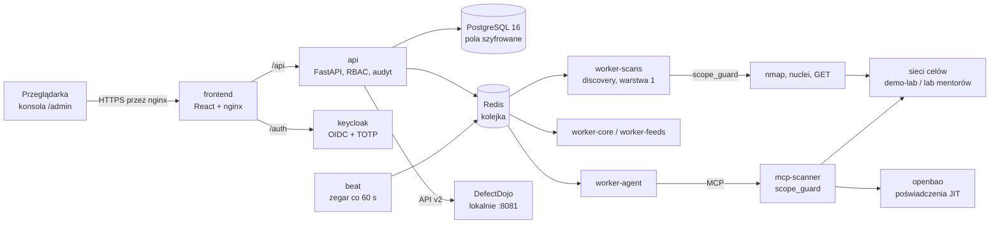

# Sentinel ASI: dokumentacja techniczna

Dokumentacja techniczna prototypu na zadanie HackNation **„Attack Surface Intelligence”**
Centrum Bezpieczeństwa Informacji AGH (brief: [BRIEF.md](BRIEF.md), wymaganie formalne
sekcji 4, pkt 2). Stan na 22.11.2026, gałąź `sprint-final` i `main`.

Ten plik jest punktem wejścia: opisuje cały system od problemu po uruchomienie i testy, a
przy każdym temacie wskazuje dokument szczegółowy.

| Dokument | Kiedy po niego sięgnąć |
|---|---|
| [REQUIREMENTS.md](REQUIREMENTS.md) | pełna macierz zgodności z briefem, wymaganie po wymaganiu |
| [OPIS_SYSTEMU.md](OPIS_SYSTEMU.md) | każdy ekran konsoli i każdy mechanizm discovery z nazwami pól |
| [TESTOWANIE.md](TESTOWANIE.md) | uruchomienie, lab mentorów, testy, rozwiązywanie problemów |
| [ROLES.md](ROLES.md) | macierz rola × uprawnienie × endpoint, generowana z kodu |
| [WARSTWY.md](WARSTWY.md) | trzy warstwy skanowania podatności i delegacje w IAM |
| [DATA_PROTECTION.md](DATA_PROTECTION.md) | szyfrowanie w spoczynku, klucz, rotacja |
| [PERFORMANCE.md](PERFORMANCE.md) | pomiary skali (/18, 16 384 adresy) |
| [LAB_TEST.md](LAB_TEST.md) | test silnika discovery na labie mentorów bez stawiania aplikacji |
| [SCENARIUSZ_FILMU.md](SCENARIUSZ_FILMU.md) | scenariusz filmu demo 2–3 min |
| [ARCHITECTURE.md](ARCHITECTURE.md) | historia decyzji projektowych (dokument roboczy, część sekcji sprzed briefu) |

## Spis treści

1. [Problem i odpowiedź](#1-problem-i-odpowiedź)
2. [Zgodność z briefem w skrócie](#2-zgodność-z-briefem-w-skrócie)
3. [Architektura](#3-architektura)
4. [Discovery: od celu do wyniku](#4-discovery-od-celu-do-wyniku)
5. [Odpowiedzi na pytania z briefu](#5-odpowiedzi-na-pytania-z-briefu)
6. [Fingerprinting, technologie i sygnatury](#6-fingerprinting-technologie-i-sygnatury)
7. [Zmiany w czasie i hosty niestabilne](#7-zmiany-w-czasie-i-hosty-niestabilne)
8. [Harmonogram i okna czasowe](#8-harmonogram-i-okna-czasowe)
9. [Bezpieczeństwo skanera](#9-bezpieczeństwo-skanera)
10. [Dane: model, szyfrowanie, edycja](#10-dane-model-szyfrowanie-edycja)
11. [Role, IAM i audyt](#11-role-iam-i-audyt)
12. [Import, eksport, raporty i DefectDojo](#12-import-eksport-raporty-i-defectdojo)
13. [Moduły ponad brief](#13-moduły-ponad-brief)
14. [API](#14-api)
15. [Konfiguracja](#15-konfiguracja)
16. [Instalacja i uruchomienie](#16-instalacja-i-uruchomienie)
17. [Testy i jakość](#17-testy-i-jakość)
18. [Wydajność i wybór języka](#18-wydajność-i-wybór-języka)
19. [Ograniczenia i dalszy rozwój](#19-ograniczenia-i-dalszy-rozwój)
20. [Słownik](#20-słownik)

---

## 1. Problem i odpowiedź

**Problem (brief, sekcja 1).** Duża organizacja ma sieć liczącą ponad 10 000 adresów. Część
systemów odpowiada tylko o pewnych porach, a jednorazowy skan nie pokazuje pełnego obrazu.
Zespół bezpieczeństwa potrzebuje wiedzieć nie tylko, które porty są otwarte, ale co pod nimi
działa (panel administracyjny, CMS, środowisko testowe, stary komponent), jak to się zmienia
w czasie i jak przekazać obserwacje do DefectDojo.

**Odpowiedź.** Sentinel ASI to aplikacja webowa dla zespołu bezpieczeństwa, która:

1. przyjmuje cele (IP, CIDR, domeny) z formularza, pliku CSV, JSON lub TXT i harmonogramu,
2. skanuje je wielowątkowo nmapem w paczkach dobieranych do zmierzonej szybkości, z limitem
   tempa i w oknach czasowych,
3. rozpoznaje usługi, pobiera podstawowe informacje HTTP/HTTPS i TLS, wykrywa technologie,
   CMS-y, panele, środowiska testowe, ciekawe nagłówki i ciasteczka,
4. porównuje przebiegi, oznacza nowe, znikające i zmienione usługi oraz śledzi hosty
   niestabilne,
5. przechowuje wyniki w PostgreSQL z polami wrażliwymi zaszyfrowanymi, pozwala je poprawiać
   ręcznie (poprawki przeżywają kolejne skany), eksportuje JSON, CSV i nmap XML,
6. wysyła wybrane obserwacje do DefectDojo jako findingi informacyjne,
7. rozdziela funkcje na cztery role z briefu i role własne, z MFA i dziennikiem audytu.

**Zasady, których pilnuje kod, a nie tylko dokumentacja:**

- każde działanie sieciowe przechodzi przez `scope_guard` (zatwierdzony zakres, limity tempa),
  również u agenta AI i w serwerze MCP,
- brak aktywnej eksploatacji: wykrywanie hostów, rozpoznanie usług, pojedyncze żądania GET,
- uprawnienia sprawdza backend na każdym endpoincie, domyślnie odmowa (deny-by-default),
- każda akcja ludzi, harmonogramu i agenta trafia do dziennika audytu z łańcuchem skrótów,
- poświadczenia tylko just-in-time (OpenBao), nigdy w bazie, logach, API ani kontekście modelu,
- zewnętrzny model językowy domyślnie wyłączony, a włączony dostaje wyłącznie dane
  zanonimizowane,
- w repozytorium tylko fikcyjne dane demo i syntetyczne fixture'y.

## 2. Zgodność z briefem w skrócie

Pełna macierz z odnośnikami do kodu: [REQUIREMENTS.md](REQUIREMENTS.md). Stan: wszystkie 16
punktów sekcji 2, oba akapity o sygnaturach i harmonogramie, cały zakres minimalny i 12 z 12
punktów walidacji są spełnione. Z zakresu mile widzianego częściowo zostaje integracja ze
źródłami pasywnymi, bo organizator ich jeszcze nie udostępnił.

| Brief, sekcja 2 | Rozdział tej dokumentacji |
|---|---|
| 1. Lista IP, CIDR, domen | [4.1](#41-cele-i-walidacja) |
| 2. Bezpieczny, wielowątkowy skan, czas trwania, podgrupy | [4.2](#42-sweep-w-paczkach-adaptacyjnych), [9](#9-bezpieczeństwo-skanera) |
| 3. Aktywne hosty | [4.2](#42-sweep-w-paczkach-adaptacyjnych), [4.3](#43-ponowna-próba-dla-hostów-niestabilnych) |
| 4. Podstawowe usługi | [4.4](#44-skan-usług) |
| 5. HTTP/HTTPS: tytuł, kod, nagłówki, ciasteczka, TLS, przekierowania | [6.1](#61-fingerprint-httphttps-i-tls) |
| 6. CMS, framework, serwer aplikacyjny, IoT | [6.2](#62-technologie-i-cms-y) |
| 7. Staging, panel administracyjny | [6.3](#63-flagi) |
| 8–9. Porównanie przebiegów, nowe, znikające, zmienione | [7](#7-zmiany-w-czasie-i-hosty-niestabilne) |
| 10. Własne sygnatury | [6.4](#64-własne-sygnatury) |
| 11. Formularz, ręcznie, CSV, JSON | [4.1](#41-cele-i-walidacja), [12](#12-import-eksport-raporty-i-defectdojo) |
| 12–13. RBAC i cztery role | [11](#11-role-iam-i-audyt) |
| 14. Edycja niezależna od skanu | [10.3](#103-ręczne-poprawki) |
| 15. Czytelny interfejs i dashboard | [4.6](#46-konsola) |
| 16. Szyfrowanie w spoczynku | [10.2](#102-szyfrowanie-w-spoczynku) |

| Kryterium oceny (sekcja 8) | Waga | Główne elementy |
|---|---|---|
| Discovery i identyfikacja usług w dużej sieci | 30% | paczki adaptacyjne, workery, `-sn -PE -PS`, ponowna próba, `-sV`, pomiar /18 |
| Zmiany w czasie, hosty niestabilne, raportowanie | 15% | porównanie dowolnych przebiegów, stany hostów, pora dnia, raport przebiegu |
| Jakość, dokumentacja, prezentacja, import/eksport, DefectDojo | 20% | jedna komenda startu, JSON/CSV/nmap XML, lokalne DefectDojo z deduplikacją |
| Bezpieczeństwo, kontrola intensywności, dashboard | 15% | scope_guard, T3 maksimum, `--max-rate`, okna, kill switch, pulpit |
| Fingerprinting, technologie, CMS, nagłówki, ciasteczka, sygnatury | 10% | fingerprint HTTP/TLS, favicon mmh3, sygnatury YAML z testem bez sieci |
| Role i zabezpieczenie danych | 10% | 4 role + role własne, MFA, audyt, Fernet na polach wrażliwych |

## 3. Architektura

### 3.1 Widok komponentów



### 3.2 Usługi Docker Compose

| Usługa | Rola |
|---|---|
| `frontend` | konsola React (Vite, Tailwind, React Query) pod `/admin/`, nginx z proxy do API i Keycloaka |
| `api` | FastAPI: REST, RBAC, audyt, szyfrowanie pól, walidacja celów, dokumentacja OpenAPI pod `/api/docs` |
| `worker-scans` | Celery, kolejka `scans`: przebiegi discovery (nmap, fingerprint HTTP/TLS), warstwa 1 red team |
| `beat` | zegar Celery: co minutę harmonogram discovery, cykliczne feedy i testy agenta |
| `worker-core`, `worker-feeds` | dopasowanie oprogramowania do CVE, synchronizacja NVD, CISA KEV, EPSS (moduł dodatkowy) |
| `worker-llm`, `ollama` | lokalny model językowy, opcjonalny (profil `llm`) |
| `worker-agent`, `mcp-scanner`, `worker-harness` | agent AI, serwer narzędzi MCP, test bezpieczeństwa agenta |
| `db` | PostgreSQL 16; aplikacja łączy się własnym użytkownikiem, nie administratorem bazy |
| `redis` | broker i wyniki Celery |
| `keycloak` | logowanie OIDC z TOTP, przynależność do ról |
| `openbao`, `bao-init` | sejf poświadczeń just-in-time (certyfikaty SSH na 15 min) |
| `mailpit` | lokalna skrzynka na powiadomienia e-mail |
| `lab-*` | izolowana sieć demo `172.30.99.0/24`: Apache 2.4.49, nginx 1.18.0, DVWA, Juice Shop, Redis 5.0.7, „zatruty” host, SSH |
| DefectDojo | osobny `docker-compose.defectdojo.yml`, lokalnie pod <http://localhost:8081> |

Sieci Compose są rozdzielone: `core` (API, baza, workery), `llm` i `vault` (`internal: true`,
bez wyjścia do internetu), `demo-lab` (`internal: true`, widzą ją tylko `worker-scans` i
`mcp-scanner`). Kontenery backendu działają z `read_only: true`, `cap_drop: ALL` i
`no-new-privileges`.

### 3.3 Technologie

| Warstwa | Technologia |
|---|---|
| Backend | Python 3.12, FastAPI, SQLAlchemy 2, Alembic, Celery, Pydantic |
| Skanowanie | nmap (C/C++), nuclei (Go, tylko warstwa 1 i weryfikacja CVE), klient HTTP z limitem |
| Frontend | React 18, TypeScript, Vite, Tailwind 4, React Query, Recharts |
| Tożsamość | Keycloak (OIDC, TOTP) |
| Dane | PostgreSQL 16, Redis, szyfrowanie Fernet (biblioteka `cryptography`) |
| Integracje | DefectDojo API v2, OpenBao, MCP |
| Testy | pytest, ruff, mypy, Playwright, promptfoo (testy AI) |

Wszystko jest open source i nie wymaga licencji (brief, sekcja 5).

### 3.4 Kod

```
backend/app/
  api/          endpointy REST (discovery.py, iam.py, redteam.py, agent.py, scans.py, …)
  discovery/    silnik discovery: engine.py, fingerprint.py, signatures.py, analysis.py,
                schedule.py, io.py (import/eksport), report.py, defectdojo.py
  scanners/     adaptery narzędzi (nmap, nuclei), SubprocessRunner z listą dozwolonych binarek
  core/         scope_guard.py, audit.py, crypto.py, config.py, db.py
  iam/          RBAC (rbac.py, deps.py), delegacje warstw (delegation.py), generator ROLES.md
  redteam/      trzy warstwy: engine.py (warstwa 1), analysis.py (warstwa 2), groups.py
  agent/, planner/, mcp_server/, credentials/, agent_tests/   agent AI i jego zabezpieczenia
  assistant/    Sentek, techniczny asystent
  models/       tabele SQLAlchemy;   workers/   zadania Celery
backend/alembic/versions/   migracje (0001–0020)
rules/          konfiguracja deklaratywna: discovery, sygnatury, zakres, role, warstwa 1
frontend/admin, frontend/shared   konsola; frontend/e2e   testy Playwright
scripts/        start, seed demo, DefectDojo, lab mentorów, pomiary
demo-lab/       definicje celowo podatnych usług demo
```

## 4. Discovery: od celu do wyniku

```
cele (formularz / CSV, JSON, TXT / harmonogram)
  → walidacja składni i limitu adresów                (parse_targets)
  → „Sprawdź cele”: decyzja scope_guard na każdy cel   (POST /api/discovery/targets/preview)
  → przebieg w kolejce                                  (audyt discovery_requested)
  → sweep: paczki CIDR, nmap -sn                        (każda paczka: scope_guard, czas, wynik)
  → ponowna próba /32 dla hostów widzianych wcześniej, a teraz cichych
  → skan usług aktywnych hostów, nmap -sV               (każdy host: scope_guard)
  → fingerprint HTTP/HTTPS + TLS + sygnatury            (tylko GET)
  → flagi z dowodami i pewnością
  → zapis obserwacji po każdej paczce (pola zaszyfrowane)
  → koniec: done / stopped / paused (koniec okna, reszta celów zapisana)
  → stany hostów, porównanie, raport, eksport, DefectDojo
```

### 4.1 Cele i walidacja

`parse_targets` (`backend/app/discovery/engine.py`) rozpoznaje IPv4, IPv6, CIDR i domeny,
zgłasza błędy składni z numerem wiersza i liczy adresy. Ta sama funkcja obsługuje cele
wpisane ręcznie, z pliku CSV (kolumna `target`), JSON (lista `targets`) i TXT oraz cele
harmonogramu, więc wszystkie źródła są przetwarzane identycznie (brief, pkt 11). Jeden
przebieg obejmuje najwyżej `limits.addresses` = 70 000 adresów (/16 z zapasem). Domena jest
rozwiązywana, a każdy jej adres (IPv4 i IPv6) dostaje osobną decyzję `scope_guard`.

„Sprawdź cele” pokazuje dla każdego celu liczbę adresów, decyzję zakresu i powód, zanim
cokolwiek wyjdzie do sieci. Dopiero wtedy aktywny jest przycisk „Uruchom skan”.

### 4.2 Sweep w paczkach adaptacyjnych

Zakres jest dzielony na paczki CIDR. Pierwsza ma 256 adresów, kolejne rosną albo maleją w
granicach 16–1024 tak, żeby paczka trwała około 20 s (`batch_target_seconds`). Równolegle
działa `workers` procesów nmap (domyślnie 4, limit 16), każdy z `--max-rate` (domyślnie 300
pakietów/s, limit 2000). Polecenie:

```
nmap -sn -n -PE -PS<40 portów wykrywania> -T3 --max-rate <tempo> -oX - <paczka>
```

`-PE` to ICMP echo, `-PS` to TCP SYN na porty typowe dla usług wewnętrznych, więc hosty z
zablokowanym ICMP i tak odpowiadają. Każda paczka ma zapisany rozmiar, czas, liczbę hostów i
decyzję `scope_guard`. Postęp, przepustowość i ETA liczone są z mierzonej szybkości, a czas
całego przebiegu jest widoczny w konsoli, raporcie i eksporcie (brief: „sprawdzenie czasu
trwania skanu” i „podział na optymalne podgrupy”).

### 4.3 Ponowna próba dla hostów niestabilnych

Adresy, które odpowiadały w poprzednim przebiegu tego samego zakresu, a teraz milczą, dostają
drugą, pojedynczą próbę (/32 lub /128) w tym samym przebiegu (najwyżej 256 hostów).
Podsumowanie przebiegu mówi, ilu sprawdzono i ilu odpowiedziało.

### 4.4 Skan usług

Każdy aktywny host: `nmap -sV -Pn -n -T3 --max-rate <tempo> -p <porty usług> --open`.
Wynik to port, protokół, usługa, produkt i wersja. Usługi o tym samym porcie, nazwie,
produkcie i wersji są grupowane („Grupy podobnych usług”, mile widziany zakres).

### 4.5 Zatrzymanie

„Zatrzymaj” kończy rozpoczęte paczki i nie startuje nowych. Kill switch (agent i skany)
dodatkowo przerywa uruchomione procesy przez wspólny rejestr procesów.

### 4.6 Konsola

Konsola pod <http://localhost:8080/admin/> wymaga logowania z TOTP. Menu pokazuje tylko to,
do czego rola ma uprawnienia; backend i tak sprawdza każde żądanie.

| Grupa menu | Ekrany |
|---|---|
| Przegląd | **Pulpit**: kafelki wskaźników, ostatnie przebiegi discovery, wynik warstwy 1, sprawy do decyzji, aktywność z audytu, stan systemu; Raporty |
| Discovery | Przebiegi discovery (nowy przebieg, import, lista), strona przebiegu, Porównanie i stany, Harmonogram, Sygnatury detekcyjne |
| Skanowanie podatności | Trzy warstwy (warstwa 1, 2, 3 z osobnymi przyciskami) |
| Podatności (moduł dodatkowy) | Zasoby, Zagrożenia, Feed zagrożeń, Kolejka weryfikacji |
| Kontrola | Skany podatności, Zakres skanowania, Agent AI, Test agenta, Dziennik audytu, Role i użytkownicy, IAM |

Strona przebiegu ma statystyki (status, adresy, aktywne hosty, czas, ETA), paczki, grupy
usług, tabelę hostów z flagami, stanem, tagami i filtrem po tagu, kartę hosta z pełnym
fingerprintem i edycją, eksport, raport i wysyłkę do DefectDojo. Opis każdego pola:
[OPIS_SYSTEMU.md](OPIS_SYSTEMU.md), rozdział 4.

## 5. Odpowiedzi na pytania z briefu

Brief (sekcja 1) stawia trzy pytania. Odpowiedzi są zaimplementowane, nie tylko opisane.

**Jak raportować zmianę?** Zmiana to różnica między obserwacjami w dwóch przebiegach:
nowy host, zniknięty host, a dla hostów w obu przebiegach dodane, usunięte i zmienione
usługi (wersja, produkt), technologie, nagłówki, tytuły, flagi i nazwa
(`backend/app/discovery/analysis.py`, `compare`). Można porównać dowolne dwa przebiegi;
raport przebiegu sam porównuje z poprzednim („Najważniejsze zmiany”). Zmiany są eksportowane
do JSON i CSV, a wybrane obserwacje mogą trafić do DefectDojo. Zniknięcie hosta nie jest od
razu raportowane jako „nieaktywny” (patrz trzecie pytanie).

**Jak określić pewność identyfikacji?** Każda flaga i każda sygnatura ma listę niezależnych
dowodów (nagłówek, ciasteczko, tytuł, hash favicony, ścieżka, przekierowanie, nazwa w
certyfikacie). Pewność to liczba niezależnych dowodów: 1 to niska, 2 średnia, 3 i więcej
wysoka (`fingerprint.py`, `flags`). Dowody są widoczne na karcie hosta i w raporcie, więc
analityk widzi, na czym opiera się wynik. Fałszywy alarm można ukryć bez kasowania wyniku.

**Po jakim czasie raportować host jako nieaktywny?** Po 3 kolejnych przebiegach bez
odpowiedzi (`host_state.inactive_after_runs` w `rules/discovery.yaml`, konfigurowalne).
Wcześniej host jest „niepotwierdzony”. Host, którego odpowiedzi przeplatają się z ich brakiem
w oknie 5 ostatnich przebiegów, jest „niestabilny”. Przebieg wstrzymany na końcu okna nie
liczy się jako brak odpowiedzi, bo nie objął całego zakresu. Przed zmianą stanu host dostaje
ponowną próbę w tym samym przebiegu (4.3).

## 6. Fingerprinting, technologie i sygnatury

### 6.1 Fingerprint HTTP/HTTPS i TLS

Dla usług WWW: jedno GET na stronę główną (z przekierowaniami) i GET na ścieżki z sygnatur
(`backend/app/discovery/fingerprint.py`). Zapisywane są: kod odpowiedzi, tytuł, nagłówki
(skrócone), ciasteczka (nazwa, Secure, HttpOnly), łańcuch przekierowań, hash favicony
(MurmurHash3, jak w Shodan), technologie, kody sprawdzonych ścieżek i trafione sygnatury.
Dla HTTPS: podmiot, wystawca, daty ważności, SAN, certyfikat samopodpisany. Treści stron nie
zapisujemy (minimalizacja danych).

### 6.2 Technologie i CMS-y

Technologie rozpoznają trzy źródła, każde z dowodem:

- reguły w kodzie (`TECH_RULES` w `fingerprint.py`, zestaw jak w lekkim Wappalyzerze):
  serwery (Apache, nginx, OpenResty, IIS), frameworki i języki (PHP, ASP.NET, Java, Express,
  Laravel, Django, Angular, React, Vue.js), CMS-y (WordPress, Joomla, Drupal) i aplikacje
  (Grafana, Jenkins, Kibana, Elasticsearch, phpMyAdmin) z nagłówków, ciasteczek, meta
  `generator`, tytułu i treści strony,
- sygnatury wbudowane z `rules/signatures.yaml` (Gitea, RabbitMQ, Adminer, phpMyAdmin,
  Traefik, Nginx Proxy Manager, WordPress) i sygnatury własne,
- produkt i wersja z `nmap -sV` (serwer aplikacyjny, baza danych, broker, SSH).

Urządzenia IoT i sieciowe rozpoznaje się sygnaturą własną (tytuł, nagłówek `Server`, hash
favicony); panele routerów i konsol łapie też reguła panelu administracyjnego. Raport
przebiegu ma sekcję „Technologie” z liczbą hostów.

### 6.3 Flagi

| Flaga | Kiedy |
|---|---|
| Panel administracyjny lub logowania | tytuł (admin, login, panel, dashboard, phpMyAdmin…), formularz z hasłem, `/admin` lub `/login` odpowiada, przekierowanie do logowania, sygnatura `kind: panel` |
| Środowisko testowe / staging | nazwa hosta lub SAN (staging, test, dev, uat, qa, preprod, demo), tytuł, sygnatura `kind: staging` |
| Ciekawe nagłówki | `server`, `x-powered-by`, `x-aspnet-version`, `x-debug-token`, `x-backend-server`, `x-jenkins`, CORS |
| Ciekawe ciasteczka | nazwy z debug, admin, test, role; ciasteczko sesji bez Secure lub HttpOnly |
| Brak nagłówków bezpieczeństwa (HTTPS) | brak HSTS, CSP albo X-Frame-Options |
| TLS | certyfikat wygasły, wygasający w 30 dni, samopodpisany |

### 6.4 Własne sygnatury

Sygnatura to YAML opisujący wyłącznie, czego szukać w odpowiedzi GET (brief: „bezpieczna
detekcja obecności cech, a nie eksploatacja”):

```yaml
id: grafana-login
name: Grafana – logowanie
kind: panel                     # technology | panel | staging
match:
  - {type: title, pattern: "grafana"}
  - {type: cookie, pattern: "^grafana_session$"}
  - {type: path, path: /login, status: [200], pattern: "grafana"}
```

Typy dopasowań: `header`, `cookie`, `favicon_hash`, `html`, `title`, `generator`, `path`, czyli
dokładnie przykłady z briefu (nagłówek, ciasteczko, favicona, fragment HTML, ścieżka bez
logowania, wersja w stopce, fingerprint CMS-a). Walidator (`signatures.py`) odrzuca każde
nieznane pole, więc nie da się dopisać metody, treści żądania, poświadczeń ani parametrów;
ścieżek wszystkich sygnatur razem może być najwyżej 10.

W konsoli (Discovery → Sygnatury detekcyjne): „Sprawdź” (walidacja bez zapisu), „Zapisz”
(audyt `signature_saved`), „Testuj” (dopasowanie do zapisanego przebiegu **bez ruchu w
sieci**) i „Inspekcja” (reguły opisane po ludzku, trafienia reguła po regule, historia z 10
ostatnich przebiegów, dowody).

## 7. Zmiany w czasie i hosty niestabilne

- **Porównanie** (Discovery → Porównanie i stany): dowolne dwa przebiegi; nowe, zniknięte i
  zmienione hosty z listą zmian; eksport JSON i CSV.
- **Wykres „Zmiany w czasie”**: liczba aktywnych hostów i usług w kolejnych przebiegach.
- **Stany hostów** (okno 5 przebiegów): aktywny, niestabilny, niepotwierdzony, nieaktywny,
  z historią ✓/✗.
- **Pora dnia**: odpowiedzi w dzień (7–19) i w nocy dają etykietę „tylko w dzień” albo
  „tylko w nocy”, np. dla stacji roboczych wyłączanych na noc.
- **Ocena ciekawości** (priorytet analityczny) w raporcie: jawne wagi (panel 3, staging 3,
  TLS 2, krytyczność wysoka 2 lub krytyczna 3, nowy host 2, ciekawe nagłówki, ciasteczka,
  brak nagłówków bezpieczeństwa i stan niestabilny po 1); każda pozycja mówi, za co dostała
  punkty.

## 8. Harmonogram i okna czasowe

Discovery → Harmonogram (`backend/app/discovery/schedule.py`), dwa tryby:

- **Cyklicznie, w oknie**: częstotliwość (co godzinę … co tydzień), okno od–do (także przez
  północ, np. 22:00–06:00), dni tygodnia, strefa czasowa.
- **Jednorazowo**: dokładna data i godzina startu oraz końca.

`beat` co 60 s wywołuje `tick`. Przebieg dostaje `deadline` równy końcowi okna. Silnik przed
każdą paczką sprawdza termin: po nim kończy rozpoczęte paczki, zapisuje niezeskanowane sieci
i hosty bez skanu usług w zaszyfrowanym polu `remaining` i ustawia status „Wstrzymany”.
Cykliczny harmonogram wznawia resztę w kolejnym oknie (brief: „skan powinien zostać
zatrzymany i uruchomiony ponownie w kolejnym oknie”); jednorazowy wznawia człowiek
przyciskiem „Wznów”. Wznowienie to nowy przebieg z odnośnikiem do poprzedniego.

## 9. Bezpieczeństwo skanera

| Mechanizm | Jak działa |
|---|---|
| `scope_guard` | osobna decyzja dla każdej paczki, hosta, adresu domeny, ponownej próby i żądania HTTP; deny wygrywa z allow; odmowa w paczkach przebiegu i w audycie. Typy `ScopedNetwork` i `ScopedTarget` może wytworzyć tylko scope_guard, a adapter nmap przyjmuje wyłącznie te typy, więc nie ma ścieżki, która go omija |
| Intensywność | `-T` najwyżej 3 (T4 i T5 zablokowane), `--max-rate` i liczba workerów z limitami w `rules/discovery.yaml`, limit akcji na cel w scope_guard |
| Techniki | discovery: tylko `-sn`, `-sV` i GET; bez UDP, NSE, prób logowania, POST i fuzzingu |
| Narzędzia | `SubprocessRunner` uruchamia wyłącznie binarki z listy dozwolonych (nmap, nuclei) |
| Okna czasowe | skan kończy się na końcu okna i wraca w następnym |
| Kill switch | zatrzymuje agenta i wszystkie skany, przerywa procesy, wyłącza klienta agenta w Keycloaku i odwołuje tokeny OpenBao |
| Izolacja | sieć demo `internal: true`, adres skanera na denyliście, kontenery tylko do odczytu, bez uprawnień jądra |
| Agent AI | zdolności od administratora, plan zatwierdzany przez człowieka, każdy krok L2+ ze zgodą, narzędzia tylko przez MCP i scope_guard, test bezpieczeństwa przed aktywacją |

Warstwa 1 red team (rozdział 13.1) używa dodatkowo bezpiecznych skryptów NSE i nuclei, ale z
listą dozwolonych skryptów i tagami eksploatacji zawsze wykluczonymi.

## 10. Dane: model, szyfrowanie, edycja

### 10.1 Model danych

| Obszar | Tabele |
|---|---|
| Discovery | `discovery_run` (przebieg, cele, ustawienia, status, reszta do wznowienia), `discovery_batch` (paczka: zakres, czas, decyzja), `observation` (host w przebiegu: usługi, HTTP, flagi), `observation_override` (ręczne poprawki per IP), `discovery_schedule`, `custom_signature`, `defectdojo_export` (deduplikacja) |
| IAM | `iam_user`, `iam_role`, `iam_permission`, `iam_role_permission`, `iam_custom_role`, `iam_role_grant`, `iam_layer_delegation` |
| Audyt | `audit_log` (kto, co, kiedy, parametry, skrót poprzedniego wpisu) |
| Trzy warstwy | `redteam_run`, `redteam_finding`, `redteam_analysis` |
| Moduł podatności | `asset`, `software`, `vulnerability`, `finding`, `scan_run`, `scan_action`, `match_candidate`, `report`, `notification` i pokrewne |
| Agent | `agent_capability`, `agent_task`, `agent_step`, `credential_lease`, `agent_switch`, `agent_test_run` |

Migracje Alembic `0001`–`0020` uruchamia usługa `migrate` przy każdym starcie.

### 10.2 Szyfrowanie w spoczynku

Pola wrażliwe są w PostgreSQL jako `enc:v1:<token Fernet>` (AES-128-CBC + HMAC-SHA256,
losowy IV przy każdym zapisie), szyfrowane przy zapisie i odszyfrowywane przy odczycie przez
typy `EncryptedJSON` i `EncryptedText` (`backend/app/core/crypto.py`).

| Tabela | Pola zaszyfrowane |
|---|---|
| `observation` | `hostname`, `services`, `http`, `flags` |
| `discovery_run`, `discovery_schedule` | `targets`, `remaining` |
| `observation_override` | `value` (notatki, tagi, oceny) |
| `finding`, `asset`, `software` | `evidence`, `attributes`, `raw_banner` |
| `iam_layer_delegation` | `scope` (podsieci delegacji) |
| `redteam_run`, `redteam_finding`, `redteam_analysis` | `targets`, `log`, `ip`, `evidence`, `content` |

Jawne zostają pola potrzebne do wyszukiwania i łączenia (adres IP obserwacji, produkt i
wersja do dopasowania CVE, statusy, znaczniki czasu). Klucz `DATA_ENCRYPTION_KEY` jest tylko w
`.env` (generuje go `start.sh`), nigdy w bazie, logach ani API. Rotacja: nowy klucz do
`DATA_ENCRYPTION_KEY`, poprzedni do `DATA_ENCRYPTION_KEYS_OLD`. Test `test_crypto.py` czyta
surowe kolumny przez SQL i sprawdza brak jawnego tekstu. Szczegóły:
[DATA_PROTECTION.md](DATA_PROTECTION.md).

### 10.3 Ręczne poprawki

Na karcie hosta (`findings:update`): nazwa hosta, notatka, tagi, ukryte flagi, krytyczność i
status obsługi. Poprawki są zapisane osobno od wyników skanu, per adres IP i zaszyfrowane, a
przy odczycie łączone z wynikami. Kolejny skan ich nie kasuje (brief, pkt 14), host ma
znacznik „zmienione ręcznie”, a każda zmiana jest w audycie. Edytować można też
harmonogramy, sygnatury, role i zakres.

## 11. Role, IAM i audyt

### 11.1 RBAC

Źródłem prawdy jest `rules/roles.yaml`; Keycloak przechowuje tylko przynależność do ról, a
backend wylicza uprawnienia przy każdym żądaniu. Każdy endpoint deklaruje dokładnie jedną
regułę dostępu (`require(uprawnienie)`, `authenticated()` albo `public_endpoint()`); test
`test_every_route_declares_access` nie przepuści trasy bez deklaracji. Odmowa to 403 i wpis
`access_denied` w audycie. Uprawnienia oznaczone `mfa: true` działają tylko z tokenem po
drugim składniku.

| Rola | Nazwa z briefu | Najważniejsze możliwości |
|---|---|---|
| `administrator` | Administracja | wszystko: użytkownicy i role, zakres, integracje, audyt, agent i trzy warstwy, delegacje |
| `editor` | Dodawanie, usuwanie, modyfikacja | przebiegi, harmonogram, sygnatury, import, edycja wyników, DefectDojo, zatwierdzanie akcji L2/L3 zwykłych skanów |
| `modifier` | Modyfikacja i odczyt | edycja istniejących wyników i statusów, odczyt, eksport; bez uruchamiania i dodawania |
| `viewer` | Odczyt | odczyt, porównanie, raporty, eksport JSON/CSV, test sygnatur na zapisanych danych |

Zawieranie ról pilnuje test: `viewer` ⊂ `modifier` ⊂ `editor` ⊂ `administrator`.
Administrator tworzy w konsoli **role własne** z listy uprawnień (brief, pkt 12), z
wyjątkiem uprawnień zarezerwowanych (`iam:manage`, `agent:task`, `redteam:layer1/2/3`), co
zamyka eskalację przez edytor ról. Macierz rola × endpoint: [ROLES.md](ROLES.md).

### 11.2 Panel IAM: tożsamości ludzkie i nieludzkie

Kontrola → IAM (`/iam`) ma dwie zakładki:

- **Human**: trzy warstwy skanowania podatności z listą osób, które mają do nich dostęp (z
  roli albo z delegacji); ludzie i ich role; formularz delegacji; lista delegacji ze stanem
  (aktywna, zaplanowana, wygasła, odwołana) i przyciskiem odwołania.
- **Non-human**: agent AI jako tożsamość warstwy 3, którego „rolą” są zdolności (narzędzia,
  cele, najwyższy poziom, limity) nadawane przez administratora i aktywne dopiero po
  zaliczonym teście bezpieczeństwa; role techniczne `agent` i `system` bez uprawnień do API;
  konta techniczne, które wywołały API.

**Delegacja** daje konkretnej osobie jedną warstwę, na konkretnych podsieciach (każda w
zakresie skanowania), w oknie czasu najwyżej 30 dni, z powodem w audycie. Działa tylko w
oknie i tylko po logowaniu z MFA; cel spoza podsieci delegacji daje 403. Odwołanie działa od
następnego żądania.

### 11.3 Dziennik audytu

Każda akcja ludzi, harmonogramu i agenta (logowania do konsoli, przebiegi, eksporty,
sygnatury, poprawki, nadania ról, delegacje, decyzje scope_guard, odmowy dostępu, kroki
agenta) jest wpisem z autorem, czasem, akcją, celem i parametrami. Wpisy tworzą łańcuch
skrótów (każdy zawiera skrót poprzedniego), więc usunięcie lub zmiana wpisu jest wykrywalna.
Odczyt i eksport ma tylko administrator.

## 12. Import, eksport, raporty i DefectDojo

| Funkcja | Formaty | Uprawnienie |
|---|---|---|
| Import celów | formularz, CSV (kolumna `target`), JSON (`{"targets": [...]}`), TXT | `scan:run` |
| Import wyników | JSON (`[{ip, hostname, services[], http[]}]` albo `{"hosts": [...]}`), CSV (`ip`, opcjonalnie `hostname, port, protocol, service, product, version`), nmap XML (`-oX`) | `inventory:write` |
| Eksport przebiegu | JSON (pełne dane), CSV (`ip, hostname, port, protocol, service, product, version, title, technologies, flags`), nmap XML | `reports:export` |
| Eksport porównania | JSON, CSV | `reports:export` |
| Raport przebiegu | HTML (do druku i PDF), JSON, CSV | `reports:export` |
| DefectDojo | findingi `Info` przez API v2 | `defectdojo:export` |

Import wyników tworzy przebieg typu import, który dalej przechodzi tę samą ścieżkę co skan
(porównanie, stany, eksport). Komórki CSV zaczynające się od `=`, `+`, `-`, `@` są
neutralizowane (ochrona przed formułami w arkuszu).

**Raport przebiegu** ma sekcje: podsumowanie, najważniejsze zmiany względem poprzedniego
przebiegu, priorytet analityczny, flagi z dowodami, certyfikaty TLS, stany hostów, grupy
usług i technologie.

**DefectDojo** stoi lokalnie (`docker-compose.defectdojo.yml`, <http://localhost:8081>);
`start.sh` zakłada product, engagement, test i token i zapisuje je w `.env`. Z discovery
zaznaczone hosty idą jako findingi informacyjne (engagement „Sprint final”, test
„Discovery”); z warstwy 1 idzie jeden finding na grupę podatności z listą endpointów
(engagement „Red team: warstwa 1”). Identyfikator findingu zależy od treści, więc ponowna
wysyłka nie dubluje zgłoszeń (tabela `defectdojo_export`). Drogą awaryjną jest eksport nmap
XML i import przez parser wbudowany w DefectDojo. Do DefectDojo nie trafiają logi aplikacji.

## 13. Moduły ponad brief

Te moduły nie są wymagane przez brief. W menu mają osobne grupy, a discovery działa bez nich.

### 13.1 Trzy warstwy skanowania podatności

Szczegóły: [WARSTWY.md](WARSTWY.md). Każda warstwa ma własne uprawnienie, endpoint i
przycisk; żadna nie startuje sama, a warstwa 1 nie zleca warstwy 2.

| | Warstwa 1 | Warstwa 2 | Warstwa 3 |
|---|---|---|---|
| Co robi | deterministyczny skan narzędziami red team | analiza logów warstwy 1 i zalecenia naprawy | autonomiczny agent AI planuje sprawdzenia |
| Narzędzia | nmap `-sV` z listą bezpiecznych skryptów NSE (TLS, SSH, SMB, HTTP, FTP), nuclei z tagami `cve, misconfig, exposure, ssl`; tagi eksploatacji zawsze wykluczone | brak; domyślnie szablon reguł, model przez API jako opcja (`REDTEAM_LLM`) | narzędzia MCP ze zdolności agenta |
| Uprawnienie | `redteam:layer1` | `redteam:layer2` | `redteam:layer3` |
| Wynik | podatności pogrupowane po rodzaju (`group_key`) z listą endpointów i dowodów, na stronie przebiegu i na pulpicie, DefectDojo | ryzyko, kroki naprawy, kolejność działań; w DefectDojo jako `mitigation` | plan, zgody, wyniki kroków |

Domyślnie dostęp ma tylko administrator; innym daje go delegacja (11.2). Model w warstwie 2
dostaje wyłącznie dane zanonimizowane (adresy, domeny i nazwy z inwentarza zamienione na
znaczniki), a odpowiedź musi pasować do schematu JSON.

### 13.2 Agent AI

Zadanie w języku naturalnym → plan modelu albo z szablonu → walidator planu (cele, narzędzia,
poziomy ze zdolności) → zatwierdzenie przez człowieka → wykonanie przez serwer MCP, gdzie
każde wywołanie przechodzi przez politykę i scope_guard. Poświadczenia SSH wystawia OpenBao na
15 minut na zadanie i odwołuje po kroku. Wyniki narzędzi wracają do modelu jako niezaufane
dane. Test bezpieczeństwa agenta (wstrzyknięcia poleceń w banerach, tytułach, opisach CVE)
jest bramką zmian konfiguracji; wyniki są podpisane Ed25519 (`ai-tests/RESULTS.md`).

### 13.3 Moduł podatności

Inwentarz zasobów, dopasowanie oprogramowania do CVE z feedów NVD, CISA KEV i EPSS (w trybie
offline ze snapshotów), ocena ryzyka z rozbiciem na składniki, kolejka weryfikacji dopasowań
o niskiej pewności, raporty i powiadomienia.

### 13.4 Sentek

Asystent w prawym dolnym rogu konsoli odpowiada na pytania techniczne o skanowanie i wyniki
(„Co się zmieniło od ostatniego skanu?”, „Które hosty są niestabilne?”, „Jakie flagi nmap
uruchamia Sentinel?”). Odpowiedzi buduje kod z danych w bazie, w granicach uprawnień
pytającego, i z wiedzy zapisanej w kodzie. Niczego nie uruchamia ani nie zmienia.

## 14. API

Pełna, interaktywna dokumentacja OpenAPI: <http://localhost:8080/api/docs>. Uprawnienie
każdej trasy: [ROLES.md](ROLES.md).

| Prefiks | Zawartość |
|---|---|
| `/api/discovery` | ustawienia, podgląd celów, przebiegi (start, stop, wznowienie), hosty, eksport, raport, porównanie, stany, poprawki, import, harmonogram, sygnatury (zapis, test, inspekcja), DefectDojo |
| `/api/iam` | uprawnienia, role (też własne), użytkownicy i nadania ról, delegacje warstw, tożsamości nieludzkie |
| `/api/redteam` | warstwy i dostęp, przebiegi warstwy 1, analiza warstwy 2, wysyłka grup do DefectDojo |
| `/api/agent` | zadania, plany, zatwierdzenia, zdolności, kill switch, test agenta |
| `/api` (pozostałe) | zasoby, zagrożenia, feedy, skany podatności, zakres, raporty, powiadomienia, audyt, Sentek, `/api/health` |

Najważniejsze trasy discovery:

| Metoda i ścieżka | Uprawnienie | Co robi |
|---|---|---|
| `POST /api/discovery/targets/preview` | `scan:read` | walidacja celów i decyzja scope_guard bez skanu |
| `POST /api/discovery/runs` | `scan:run` | nowy przebieg (workery, tempo, `-T`, opcjonalny koniec) |
| `POST /api/discovery/runs/{id}/stop`, `/resume` | `scan:run` | zatrzymanie, wznowienie |
| `GET /api/discovery/runs/{id}/hosts` | `scan:read` | hosty z poprawkami i stanami |
| `GET /api/discovery/runs/{id}/export?format=json\|csv\|nmap` | `reports:export` | eksport |
| `GET /api/discovery/runs/{id}/report?format=html\|json\|csv` | `reports:export` | raport |
| `GET /api/discovery/compare` | `scan:read` | różnice dwóch przebiegów |
| `PUT /api/discovery/overrides/{ip}` | `findings:update` | ręczna poprawka |
| `POST /api/discovery/import` | `inventory:write` | import wyników |
| `POST /api/discovery/defectdojo/export` | `defectdojo:export` | wysyłka do DefectDojo |

## 15. Konfiguracja

| Plik | Zawartość |
|---|---|
| `rules/discovery.yaml` | domyślne workery, tempo, `-T`, paczki, porty wykrywania i usług, ścieżki HTTP; limity; progi stanów hostów |
| `rules/signatures.yaml` | sygnatury wbudowane |
| `rules/scope.yaml`, `scope.demo.yaml`, `scope.mentor-lab.yaml` | zatwierdzony zakres (allow/deny), limity tempa per cel |
| `rules/roles.yaml` | uprawnienia i role |
| `rules/redteam.yaml` | warstwa 1: skrypty NSE, porty, tempo, reguły oceny, nuclei |
| `.env` | hasła, `DATA_ENCRYPTION_KEY`, dane DefectDojo, `DEMO_MODE`, `REDTEAM_LLM`, `EXTERNAL_LLM_ENABLED`; tworzony przez `start.sh`, poza Gitem |

Konfiguracja jest deklaratywna i czytelna dla audytora: progi i limity są w YAML, a nie w
kodzie. Sekrety są wyłącznie w `.env`; w repozytorium jest tylko `.env.example`.

## 16. Instalacja i uruchomienie

Wymagania: Docker z Compose (Docker Desktop na Windows i macOS), na Windows także Git for
Windows. Zalecane 4 rdzenie, 16 GB RAM i 30 GB dysku; GPU nie jest potrzebne.

```bash
./start.sh                 # Windows: .\start.cmd   — tryb demo
./start.sh --bez-demo      # bez danych demo, zakres labu mentorów
./start.sh --bez-demo --czysta-baza
```

`start.sh` tworzy `.env` z losowymi hasłami i kluczem szyfrowania, stawia lokalne DefectDojo
(product, engagement, test, token), buduje i uruchamia aplikację z siecią demo, wykonuje skan
demo, zakłada konta i czeka na `/api/health`. Pierwszy start pobiera obrazy i trwa kilka
minut.

| Co | Adres | Logowanie |
|---|---|---|
| Konsola | <http://localhost:8080/admin/> | konta z `data/demo-credentials.env`, hasło + TOTP |
| API (OpenAPI) | <http://localhost:8080/api/docs> | token z konsoli |
| DefectDojo | <http://localhost:8081> | `DD_ADMIN_USER` / `DD_ADMIN_PASSWORD` z `.env` |
| Mailpit | <http://localhost:8025> | bez logowania |

Konta demo (fikcyjne): `admin`, `editor`, `modifier`, `viewer` (cztery role z briefu) oraz
`analityk` (editor) i `operator` (modifier) do pokazu delegacji. Lab mentorów: cel
`host.docker.internal` w trybie `--bez-demo`, instrukcja w [TESTOWANIE.md](TESTOWANIE.md),
rozdział 3.

## 17. Testy i jakość

| Zestaw | Polecenie | Stan 22.11.2026 |
|---|---|---|
| Backend: testy jednostkowe i integracyjne | `cd backend && uv run pytest` | 765 testów, wszystkie zaliczone |
| Backend: lint i typy | `uv run ruff check . && uv run mypy app` | bez błędów |
| Frontend: typy, lint, build | `npx tsc -b && npm run lint && npm run build` | bez błędów |
| Frontend: e2e Playwright | `npx playwright test --trace off` | 17 testów, wszystkie zaliczone |
| Ścieżka demo na działającym stosie | `python scripts/check_demo.py http://localhost:8080` | logowanie z TOTP, role, odmowy w audycie, Sentek |
| Testy własnego AI (promptfoo) | `cd ai-tests && ./run.sh mock` | 19/19 ataków obronionych |
| Lab mentorów | [LAB_TEST.md](LAB_TEST.md) | 5/5 usług, 7/7 zmian |

Testy pilnujące zasad, a nie tylko funkcji: każda trasa deklaruje dostęp; każde wywołanie
nmap przechodzi przez scope_guard; zawieranie ról; brak jawnego tekstu w zaszyfrowanych
kolumnach; warstwy nie startują same (harmonogram ich nie zawiera); warstwa 1 jest
deterministyczna; sygnatura z nieznanym polem jest odrzucana. CI (GitHub Actions,
`.github/workflows/ci.yml`) przy każdym pull requeście i pushu do `main` uruchamia lint,
format, typy i testy backendu, migracje, e2e frontendu, budowę obrazów ze skanem Trivy
oraz testy AI na atrapie modelu.

## 18. Wydajność i wybór języka

Pomiar na prawdziwym nmapie w izolowanej przestrzeni sieciowej, zakres `/18` (16 384
adresy), 16 workerów, `max_rate` 1000, T3, wszystkie fazy:

| Metryka | Wynik |
|---|---:|
| Aktywne hosty / usługi / fingerprinty HTTP / flagi | 48 / 72 / 24 / 80 |
| Czas całości | 6 217 s (ok. 104 min), 2,6 adresu/s |
| CPU: Python / nmap | 5,7 s / 1 340,7 s |
| Szczyt RSS: Python / jeden proces nmap | 81,8 MiB / 81,7 MiB |

Prawie cały czas zajmuje sweep pustych adresów, które w laboratorium nie odpowiadają ani RST,
ani ICMP, więc każda sonda czeka na limit czasu. Przyspieszyć można mniejszą listą portów
wykrywania i wyższym `max_rate` w granicach limitów; T4 jest celowo zablokowane.

Brief sugeruje języki o niskim zużyciu zasobów. Pracę sieciową wykonuje nmap (C/C++), a
Python tylko dzieli zakres, pilnuje zakresu i zapisuje wyniki: 5,7 s CPU na 104 minuty skanu.
Przepisanie orkiestracji na Go lub Rust nie skróciłoby skanu. Szczegóły:
[PERFORMANCE.md](PERFORMANCE.md).

## 19. Ograniczenia i dalszy rozwój

- **Źródła pasywne** (mile widziany zakres): gotowe miejsce na integrację, czekamy na dane od
  organizatora.
- **Skala**: przepustowość sweepu zależy od sieci; dla zakresów /16 w krótkim oknie trzeba
  zmniejszyć listę portów wykrywania albo rozłożyć skan na kilka okien (mechanizm wznawiania
  już to obsługuje).
- **nuclei** w warstwie 1 korzysta wyłącznie z szablonów wykrywających pobranych przez
  `scripts/fetch_nuclei.sh`; szerszy zestaw wymaga dopisania szablonów do listy.
- **Certyfikaty SSH agenta** wydane przed kill switchem działają do 15 minut (brak listy
  odwołań KRL).
- **Wdrożenie produkcyjne** powinno dodać szyfrowanie dysku lub wolumenu bazy i kopii,
  TLS przed nginx oraz zewnętrzny magazyn kluczy zamiast `.env`.

## 20. Słownik

| Termin | Znaczenie |
|---|---|
| Przebieg | jedno wykonanie discovery na liście celów |
| Paczka | fragment zakresu skanowany jednym procesem nmap |
| Obserwacja | stan jednego hosta w jednym przebiegu |
| Poprawka (override) | ręczna zmiana danych hosta, zachowywana w kolejnych przebiegach |
| Flaga | wykryta cecha warta uwagi analityka, z dowodami i pewnością |
| Sygnatura | deklaratywny opis cechy odpowiedzi HTTP do wykrycia |
| scope_guard | moduł decydujący, czy dany cel wolno skanować i w jakim tempie |
| Delegacja | czasowe nadanie warstwy skanowania osobie na wskazanych podsieciach |
| L1, L2, L3 | poziomy inwazyjności akcji; L2 i L3 wymagają zgody człowieka |
